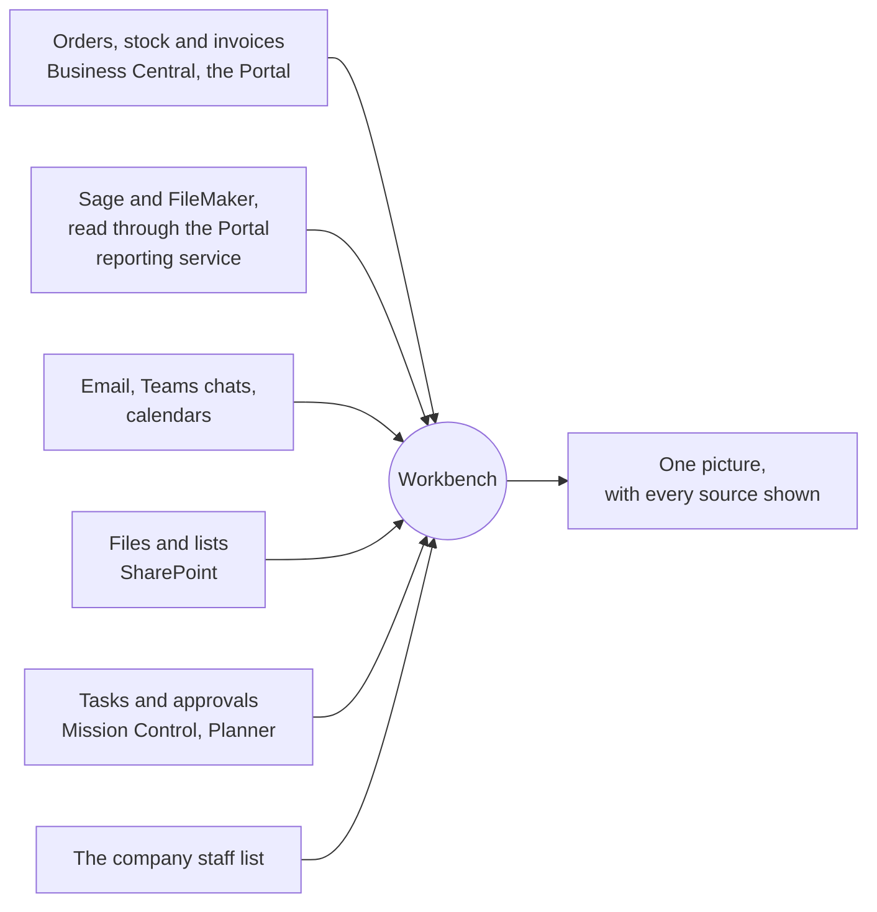
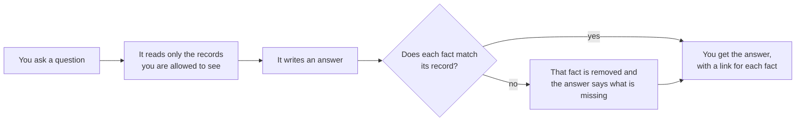
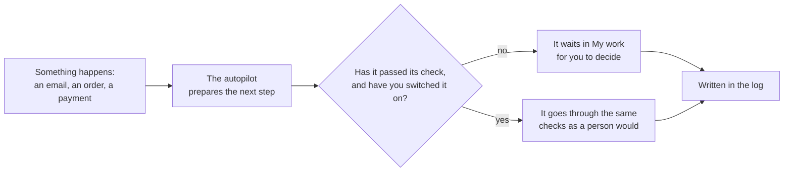

# PLX Workbench

The Workbench is one place where people at PLX can see their work, ask questions about the
business and get answers they can check. It can also prepare an email or a change for you.
Nothing is sent or changed until a person says yes.

## What it is

PLX keeps its information in many programs. Orders are in one, invoices in another, email
in a third and spreadsheets somewhere else. To answer a plain question such as "why is
this order late?", someone used to open five programs and piece the story together by hand.

The Workbench does that reading for you. It keeps a copy of what those programs hold, notes
exactly where each piece came from, and connects the pieces that belong together. This
email is about that order. That order is for this customer. This batch came from that
supplier.

When it tells you something, it shows you where it found it, so you never have to take its
word for it.

## Who it is for

It is for anyone at PLX who deals with customers, suppliers or the shop floor.

Owners and managers see what is stuck across the company and what each team is
waiting on. They can ask about any customer, order or supplier and get a short answer with
the sources attached.

Customer service and sales staff can see where an order is, what was promised and what the
customer last wrote. A reply is usually ready to send.

Purchasing sees which purchase orders are running late and what the supplier last said
about the ship date. A reminder to the supplier can be drafted in one step.

Production and quality staff can follow what goes into a product, which batch went where,
the test results, and the paperwork a shipment needs.

Finance sees invoices and payments matched to the orders they belong to.

## Where the information comes from

The Workbench only reads from these programs. It does not change anything in them on its
own.

Most of these programs are connected today. A few more, such as meeting transcripts and some
shipping and online sales services, are prepared but not switched on yet.

## Getting started

You can use the Workbench in a web browser or in the desktop app for Windows and Mac. Both
show the same pages. The desktop app can be downloaded from the Help page in the
Workbench.

Sign in with your normal Microsoft work account (Microsoft Entra ID). Your session only ever
sees the mailboxes, Teams channels, SharePoint folders, and business records that your own
account is permitted to read.

## Inside the Workbench

The workspace is organized into six focused surfaces:

1. **Home** — Your daily executive briefing. Open with a unified command bar to ask a question
   or jump straight to any order, customer, or metric. Below, a role-scoped priority queue
   surfaces the replies, decisions, and late supply items that actually belong to you (sorted
   most-actionable first, with one-click Done and Undo), paired with a **Today** calendar panel
   showing your upcoming meetings, attendees, and one-click Join links.
2. **Ask** — Ask any question in plain English across orders, suppliers, lots, finance, mail,
   and Teams. Scope your search with the top domain switcher (`All`, `Finance`, `Purchasing`,
   `Operations`, `Quality`, `Sales`), type `@` to reference specific records, or type `/` to
   run built-in workflow skills (`/late-pos`, `/qc-holds`, `/revenue-why`, `/customer-brief`,
   `/excel-tracker`, `/margin-check`, `/supplier-chase`, `/sharepoint-doc`). Every answer
   includes a collapsible **Thought process** trace showing the exact tables, governed measures,
   and records consulted, and conversations are automatically titled and organized by time.
3. **Insights** — A customizable analytics studio built on governed SQL definitions. Arrange
   and resize live charts on your **Canvas**, create new charts or scheduled **Triggers**
   directly in-page, inspect **Governed Measures & Lineage** on an interactive dotted-grid map
   (`Data tables -> Governed measures -> Dashboard tiles`) with full SQL inspection, and verify
   accuracy against golden benchmarks.
4. **Assist** — Your always-on operational assistant in a clean triage workspace (**Inbox**,
   **Suggestions**, and **Workflows**). Give Assist a job in plain English, review prepared
   email drafts and QC summaries with inline editing and one-click approval, triage actionable
   supplier follow-ups with pre-filled contacts, or build scheduled multi-step workflows that
   always stop at a human approval gate before sending or writing.
5. **Artifacts** — Create and export real business deliverables — Excel workbooks (`.xlsx`),
   Word briefs and SOPs (`.docx`), executive slide decks (`.pptx`), interactive charts, and
   purchase orders or customer quotes — built from live company records, with direct
   **Save to SharePoint** folder selection and approval-gated upload.
6. **Data & Team** — Fast, high-density directories for Orders, Customers, Suppliers, Products,
   Documents, and Production batches (opening individual record pages with instant ERP reads
   and on-demand Margin, Landed Cost, Formula, Trail, and Document sections), alongside a
   **Team** productivity and workload monitor for managers and owners.

You can also tell the Workbench how you like things done, such as your usual sign-off or a
phrase you never use, and your drafts will follow it. **Memory & Rules** shows everything it
remembers about you, and you can edit or remove any item at any time. If you send the same
kind of reply or document often, save it as a template and new drafts will start from it.

## Asking a question

You type a question the way you would ask a colleague. Before you see the answer, the
Workbench checks every fact in it against the record it came from. A fact that does not
match is taken out, and the answer tells you what it could not find.

## Autopilot

Some work comes up again and again. A supplier sends a new ship date, a customer emails a
purchase order, a payment arrives. An autopilot notices these and prepares the next step
for you, written the way you write, and puts it in My work.

Today every autopilot only prepares work. A person reads it and decides.

An autopilot can only be allowed to do more after it has been checked on at least 15 real
cases from recent days it had not been tuned on, and found right at least 9 times out of 10. Even then, it only does so for you if you
switch it on yourself. You can stop all autopilots at once at any time.

Some things never count as routine and always need a person: anything about money, prices
or credit, who can see or do what, new customers or suppliers, and matters about people.
Every step an autopilot takes is written down in a log you can read.

## Keeping information private

Two rules decide what anyone sees.

First, a small number of people at PLX are left out completely. Any email, chat, file or
meeting they are part of is dropped before the Workbench reads it, so it is never stored
or searched. If the Workbench cannot tell whether an item involves one of them, it does not
read the item.

Second, you only see what you could already open in the original program. If a record
exists that you are not allowed to open, the Workbench may tell you that something is
hidden, but never what it is. Hidden records are never used to shape your answers either.

## Behind the scenes

The Workbench keeps reading the connected programs throughout the day, so a change usually
shows up within minutes. Everything it reads is kept in one database on a company server,
together with a note of where each piece came from and who may see it. Updates to the
Workbench are switched in with a restart of under half a minute.

## Questions and feedback

If something looks wrong or could be better, choose Give feedback in your account menu
(or Help, then Give feedback, in the desktop app) and say so in a sentence or two. It goes
straight to the team that builds the Workbench, and the Feedback page shows what you have
sent. For access or a new access link, ask your manager or the person who set up your
account.

---

Engineers: architecture, code layout, running, testing and releases are in
[docs/TECHNICAL.md](docs/TECHNICAL.md).
