# PLX Workbench

One place to see your work, ask questions about PLX's business (customers, orders,
suppliers, lots, documents, meetings) and get an answer with its source. It can also
draft the email or the change for you. Nothing is sent or changed until a person
approves it.

[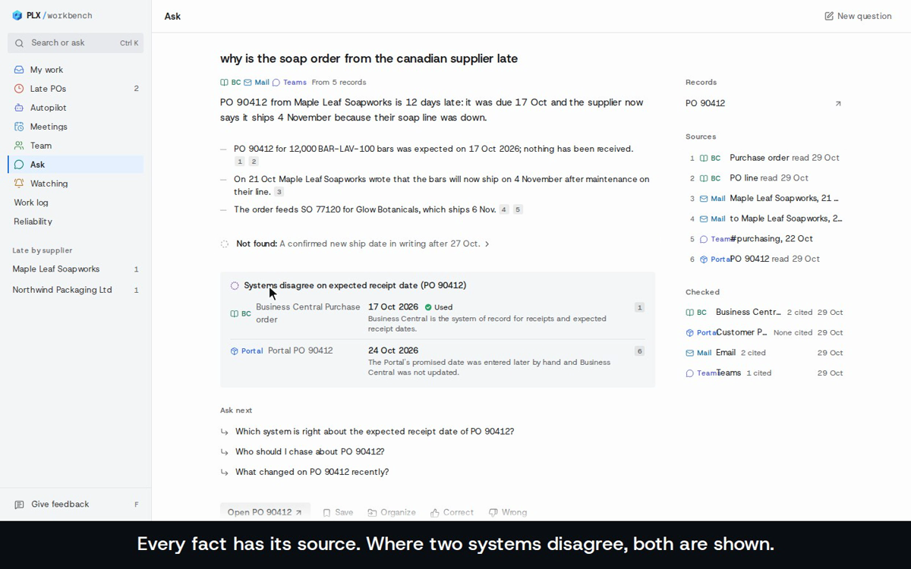](docs/media/plx-workbench-demo.mp4)

**[Watch the demo (3 min, with captions)](docs/media/plx-workbench-demo.mp4).** It uses
made-up demo data, not real company records.

## What it does

- My work shows what needs you today, from every system, in one list.
- You can ask anything. Questions about the business get an answer with the record
  behind every fact. General questions ("what is FEFO?") get a plain answer, marked as
  general.
- You can ask it to do something, like a reply, a chase or an update, and it drafts it
  from what you have open.
- Every draft waits for a person. You see exactly what will be sent
  or changed, then you confirm. One at a time.
- Autopilots prepare routine work (supplier dates, PO chasers, new customer orders)
  for you. An autopilot only acts after it has proved itself.
- Meetings shows your calendar by day or week, with a prep sheet for each meeting.
- With view-as, the owner can see a colleague's work list the way they see it, read-only.

## Where the information comes from

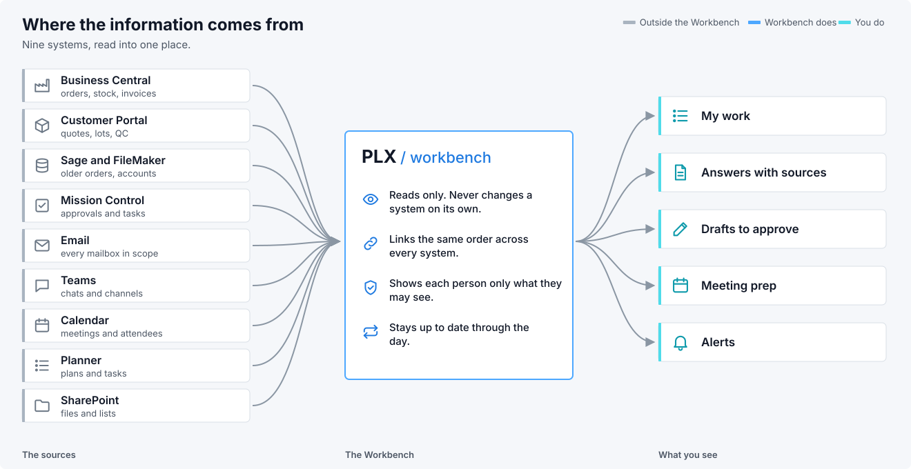

It reads these systems. It never changes one by itself.

## A day with the Workbench

### Your morning

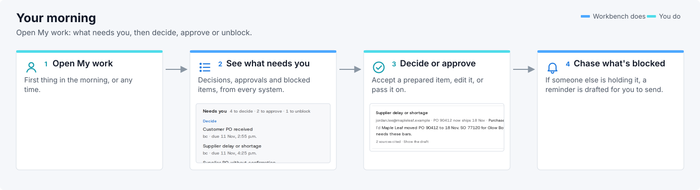

### Asking a question

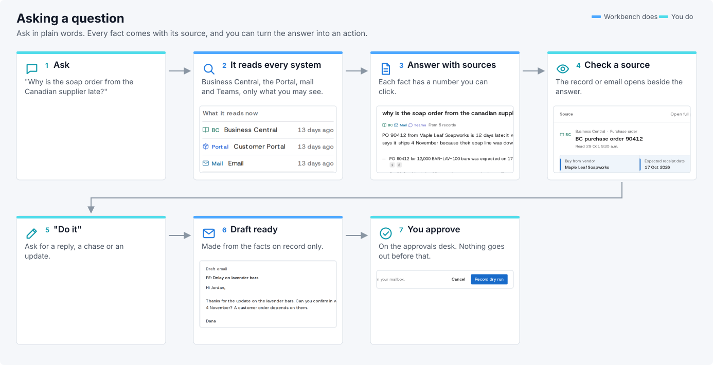

### How an action gets approved

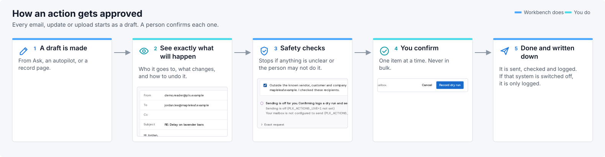

### A supplier order goes late

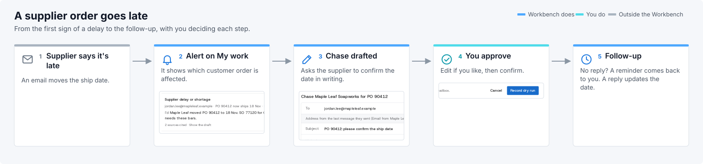

### A customer emails a purchase order

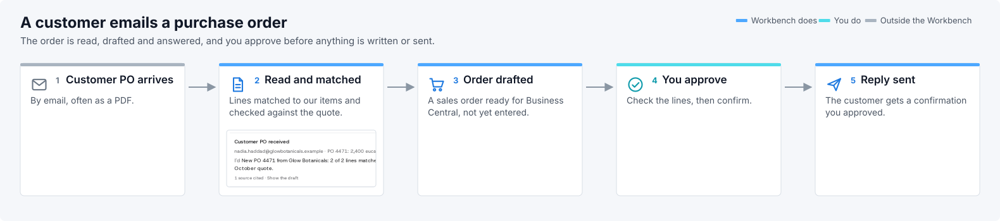

### A meeting

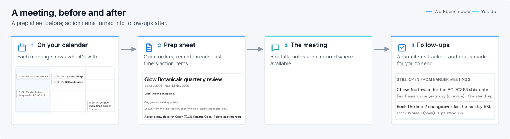

## What works today and what is waiting

**Working now:**
- Reading every system listed above.
- My work, Ask with sources, record pages, source pages, meetings and prep sheets,
  alerts, the work log and view-as.
- The approvals desk. Email sending is switched on for one approved mailbox, and
  that person still confirms every send.

**Built, but switched off until it passes its test:**
- Autopilots run in Draft mode: they prepare work and a person decides. None acts on
  its own yet, because none has passed its test on fresh days and been switched on.
- Changes in Business Central, Mission Control, the Portal, FileMaker, Teams, Planner
  and the calendar are prepared as practice runs: the exact change is written down,
  nothing is sent.
- Saving a file to SharePoint needs your own access to that folder, your confirm and
  the system's switch.
- Sage is never changed.

**Still waiting:**
- Permission to make changes in each system.
- Meeting recordings and transcripts (not connected yet).
- Amazon, Freightcom and Fiix.
- Some older Portal, Sage and FileMaker tables still need to be turned into proper
  records.
- More autopilots for every team, and logins for more people.
- Every page opening in under a second (most are quick; some are still slow).

## Using the Workbench

For people at Petra. The Workbench is a desktop app for Windows and Mac (installer coming; until then it opens in your browser at the address you were given).

1. Sign in.
2. Start with My work, ask a question in Ask, open a record such as a purchase order, or look at Autopilot and Meetings.
3. If it says **missing** or **hidden**, the data isn't there or isn't yours to see. It never guesses.
4. Something wrong or missing? Use the Feedback page inside the app.

## Running the demo locally (developers)

This is a developer demo on made-up data, not something Petra staff need to do.

1. Open a terminal in this folder.
2. Type `pip install fastapi uvicorn pydantic` and press Enter.
3. Type `python3 -m operator_api serve --mock --port 8780 --insecure-cookie` and press Enter. This starts the demo with made-up data.
4. In a second terminal, type `cd app && npm ci && npm run dev` and press Enter.
5. Open `http://localhost:3000` and click the demo sign-in.
6. Try the same pages as above. Feedback goes through the in-app Feedback page or the repo's issue tracker.

Full guide: [`context/HOW-TO-USE.md`](context/HOW-TO-USE.md).

## What's new

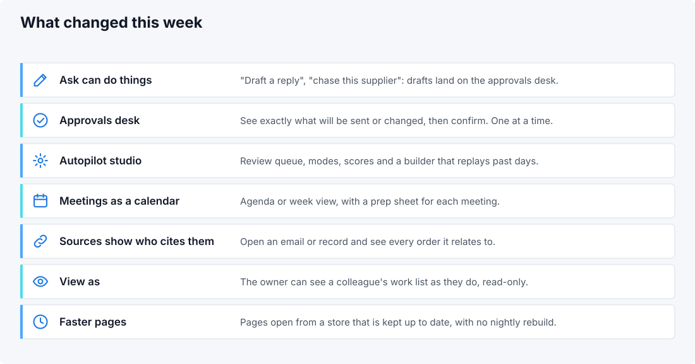

- **v0.18:** Ask asks one question back when the answer depends on a choice you have not
  made, and says what it assumed when it cannot ask; the first question after a restart
  is answered in seconds; form filling from the records; customer purchase orders come as
  an import file for the Portal or Business Central; the low-price alert is on, measured
  at 14 of 15 right on fresh days; mail from people on the exclusion list is withheld
  everywhere; sign-in, sessions and approvals are stricter (an approval lapses after 7
  days or when its person loses access).
- **v0.17:** one Workbench app; Ask can draft actions; the approvals desk; the Autopilot
  studio with its test on fresh days; meetings as a calendar with prep sheets; source
  pages that list every record citing them; view-as; data kept up to date through the
  day.
- **v0.16:** a correct late-order list, freshness per source, profitability labelled on item cost with cautious conclusions, ambiguous order numbers resolved by asking.
- **v0.15:** answers show how we know (late-PO trails with vendor confirmation, why-trails for every record type); customer profitability; the email behind a vendor price; an accuracy report.
- **v0.14:** faster refreshes that keep already-read documents; large Portal tables load in resumable steps.
- **v0.13:** questions keep working during data refreshes; R&D agenda in seconds; search by meaning measured and ready.
- **v0.12:** answers in the app checked like the scoreboard and written plainly; late POs show how late; cited maps open; disagreeing systems and duplicate files handled.

All releases: [`context/RELEASE-NOTES.md`](context/RELEASE-NOTES.md).

## How it works

This part goes a little deeper, still in plain words.

### How the systems are linked together

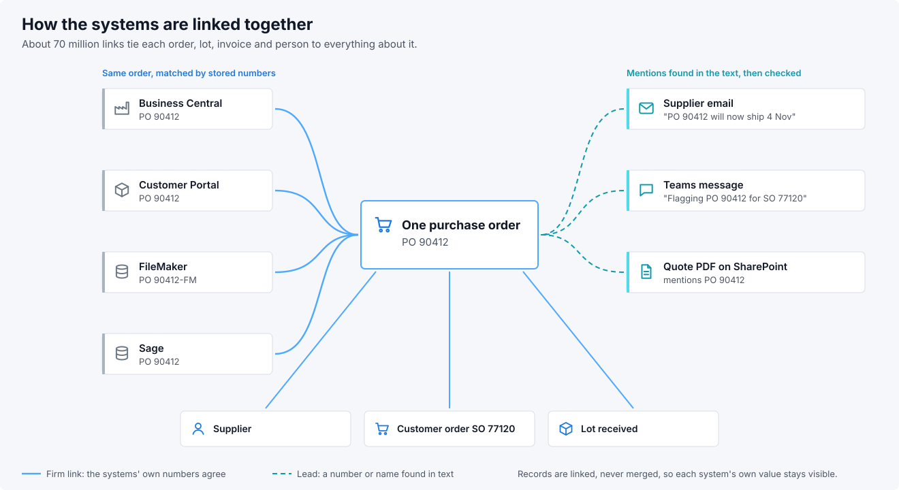

The same purchase order often lives in four systems. The Workbench keeps each copy as
its own record and links them, so you can see what each system says. When two systems
disagree, you see both.

There are two kinds of link. A **firm** link is made when the systems' own numbers
agree. A **lead** is a number or name found in the text of an email, a Teams message
or a file; it is checked before it is used. In total about 70 million links tie each
order, lot, invoice and person to everything about it. Every value remembers where it
came from and when it was read.

### How Ask finds and checks an answer

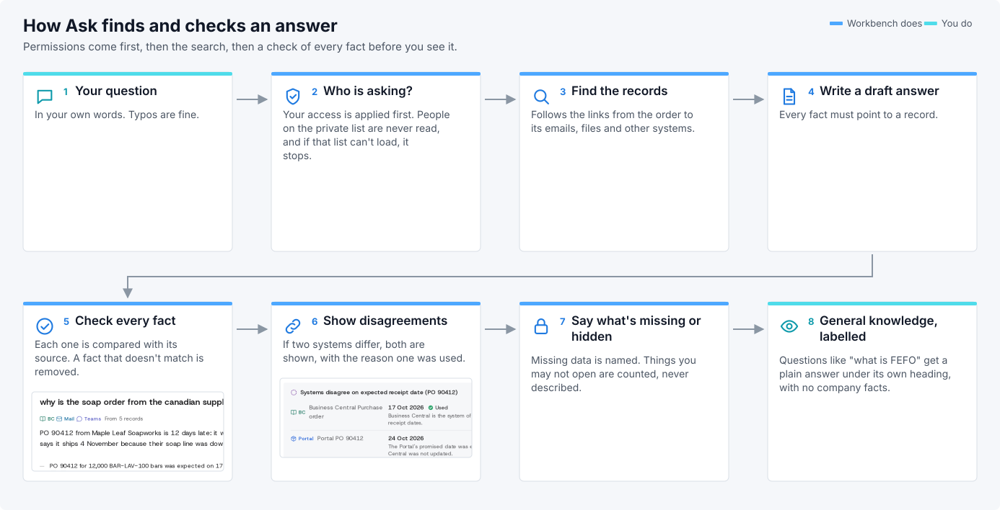

1. Who is asking comes first. You only ever get answers from what you are allowed to
   open. A short list of people is private: their mail and records are never read. If
   that list can't be loaded, Ask stops instead of guessing.
2. It follows the links from the order or customer you asked about to its emails,
   files and the other systems.
3. Every fact is checked against the record or email it cites. A fact that doesn't
   match is removed before you see it.
4. Missing data is named, with where it would normally be.
   Things you may not open are counted, never described.
5. General questions are answered separately, under their own heading, without
   access to any company record.

When you ask it to *do* something, it drafts from what you have open and sends the
draft to the approvals desk. Ask never sends anything itself.

### How an autopilot works

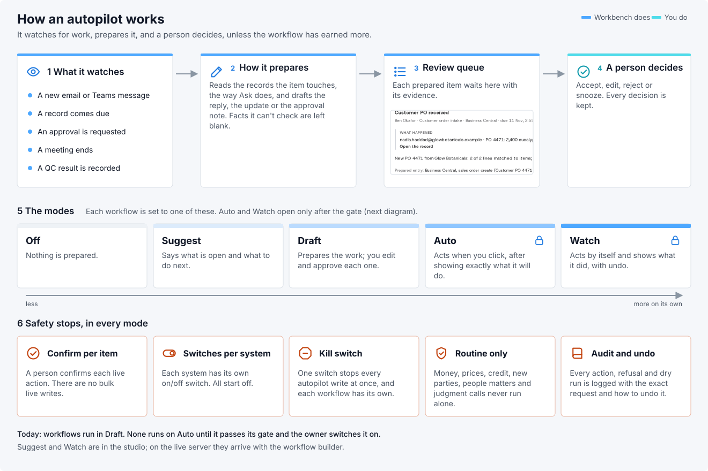

An autopilot is a workflow that does one routine job, like "a supplier states a ship
date: update the expected date and reply".

- It watches for a new email or Teams message, a record coming due, an approval
  request in Mission Control, a meeting ending, a QC result.
- To prepare an item, it reads the records the item touches, the same way Ask does,
  and drafts the reply, the update or the approval note. Anything it can't check is
  left blank for you to fill in.
- Each prepared item waits in the review queue with its evidence.
  You accept, edit, reject or snooze it.
- Each workflow is set to one of five modes:

  | Mode | What it does |
  |---|---|
  | Off | Nothing is prepared. |
  | Suggest | Says what is open and what to do next. |
  | Draft | Prepares the work; you edit and approve each one. |
  | Auto | Acts when you click, after showing exactly what it will do. Only after its test. |
  | Watch | Acts by itself and shows what it did, with undo. Only after its test. |

  Today every workflow is in Draft. Off, Draft and Auto work on the live server;
  Suggest and Watch are in the studio and come with the workflow builder.
- These safety stops apply in every mode. A person confirms each live action, and there are no
  bulk live changes. Each system has its own switch, and all start off. One kill switch
  stops every autopilot at once, and each workflow has its own. Money, prices, credit,
  new customers or suppliers, people matters and judgment calls never run on their own.
  Every action, blocked request and practice run is written down with the exact request and how
  to undo it.

### How an autopilot gets permission to act

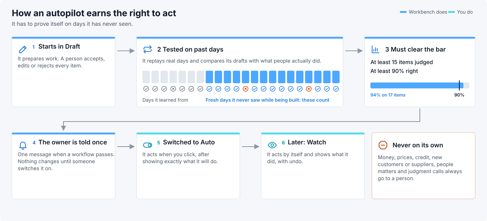

Each workflow is replayed over real past days, and its drafts are compared with what
people actually did. Only days it never saw while it was being built count. It must get
**at least 90% right on at least 15 judged items** from those fresh days. Fresh days
show how it does on work it hasn't seen; the days it was built on would flatter it. When a workflow
passes, the owner is told once. It still does nothing more until someone switches it
on.

### Keeping it up to date and fast

The Workbench reads each system's changes through the day and updates only what
changed, so there is no nightly rebuild. When the shape of the data changes (a new kind
of link, say), only the affected part is redone, inside the database, with an undo log
so it can be rolled back. Big changes are tried on a small sample first and must finish
within two hours.

### How we know it works

We keep two sets of test questions. One is used while building. The other is kept
aside and only used to decide whether a version is good enough, so the score can't be
tuned to it. The bar: at least 90% correct with evidence, at most 1% confidently wrong,
every "I don't know" backed by missing data, and the same result twice in a row.
The working goal for answers is 97% right with none wrong.

Each use case lists its open questions and what the Workbench still needs: [`docs/reference/USE-CASES.md`](docs/reference/USE-CASES.md). Full pages are in [`use-cases/`](use-cases/).
