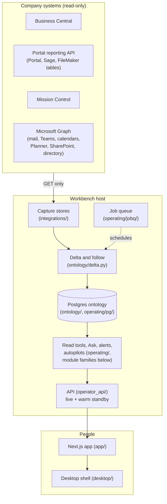
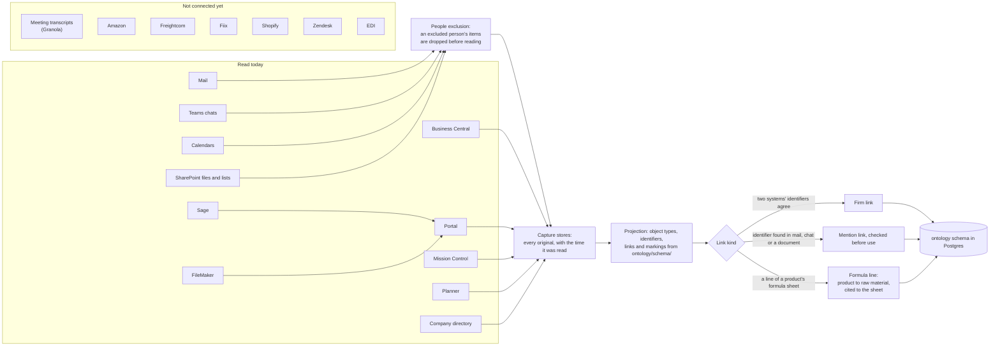
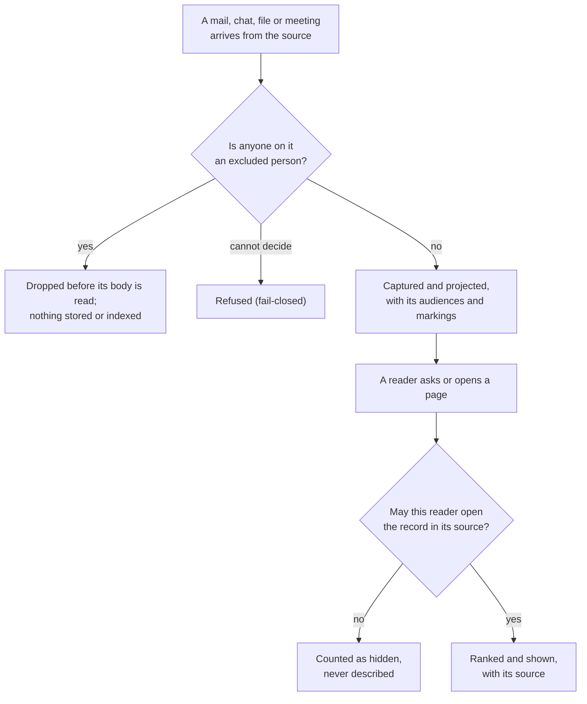
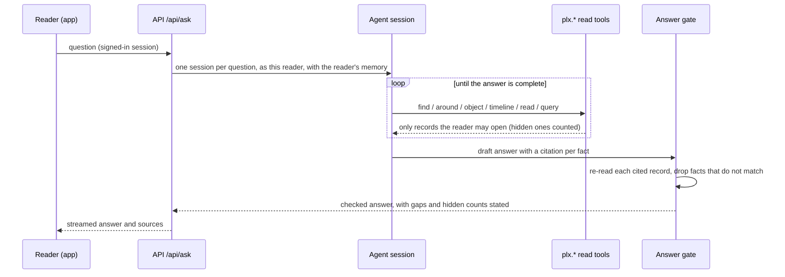
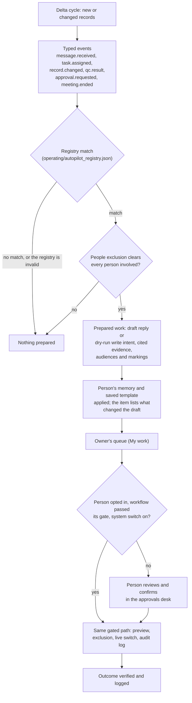
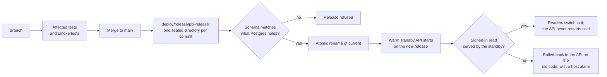

# PLX Workbench: technical guide

This is the engineers' companion to the [README](../README.md). It covers how the
Workbench is built, the module layout, how to run and test it, how changes land and are
released, the migration rules, the host configuration in `deploy/` and the security model.
The working brief in `docs/` holds the current state and the rules.

## How it is built

The Workbench is an ontology over the systems a distribution company runs on, plus the
tools people use to work with it. It reads Business Central, the customer Portal, Sage,
FileMaker (read-only), Mission Control, mail, Teams, calendars, Planner, SharePoint and the
company directory into one set of linked records, each citing the source it came from.
Four things sit on top of that:

- Answers. Ask takes a question about a customer, order, supplier, lot or document
  and answers from the records, citing the source of each fact. A fact that does not
  match its cited record is dropped before the reader sees it, and the answer says when
  data is missing or hidden from the reader.
- Alerts and My work. Detectors run over the same records (late purchase orders,
  margin erosion, demand drops and others, registered in `operating/alert_kinds.json`)
  and feed each person's work list. A detector is on by default only after a hand-checked
  sample of its alerts was at least 90% right on at least 15 items.
- Autopilots. Workflows that prepare routine work for a role: a supplier states a
  ship date, a customer sends a purchase order, a remittance arrives. Each person opts
  in, and a workflow acts only after it passes its test (see Security model).
- Assist, create and templates. One typed line ("ask the supplier for an ETA on PO
  X", "create an order from this PO") becomes a complete draft with its facts cited
  (`operating/assist.py`). The Workbench learns a person's document layouts from what
  they have sent and reuses them for new quotes, price lists and letters
  (`operating/doc_style.py`), and it fills existing forms from the records
  (`operating/doc_fill.py`).

The front end is a Next.js app (`app/`), also packaged as an Electron desktop app for
Windows and Mac (`desktop/`). Nothing here writes to a company system on its own.

### System overview



### From the sources to the ontology

Eighteen systems are in scope. Eleven are read today. Meeting transcripts have a reader
that waits on access; its Granola adapter reads meeting notes with their transcripts.
Amazon, Freightcom and Fiix have read-only adapters that are not connected yet. Three more
order channels have read-only adapters that stay off until their settings exist: Shopify
(orders, customers and fulfilments), Zendesk (tickets in the order mailbox's queue) and EDI
(purchase orders, acknowledgments and ship notices dropped as files). Sage and FileMaker are reached through the
Portal's reporting API, which mirrors their tables, so no client talks to either directly.



1. Capture (`integrations/`, `operating/host.py`). Each source has a read-only client
   (GET only) and a capture store that keeps every original with the time it was read.
   Capture runs continuously and never rebuilds anything.
2. Ontology (`ontology/`, `operating/pg/`). One schema (`ontology/schema/`) defines
   the object types, properties, identifiers, link types and markings. Records are
   projected from the captures into Postgres (schema `ontology`; tables in
   `docs/data-model.md`). There are two kinds of link: firm links, where two systems'
   identifiers agree, and mention links, from identifiers found in mail, chats and
   documents, which are checked before use. Build steps add derived links in place, for
   example `with_formula_lines` (`ontology/formula_lines.py`): one `Product.formula_line`
   per line of a product's formula sheet, to the raw material it names, each citing the
   sheet's version.
3. Delta and follow (`ontology/delta.py`, `operating/pg/ontology_delta.py`). Changed
   capture rows are projected and applied in place, so a record can be queried minutes
   after its source changes. Nothing is rebuilt from scratch: a schema, link or marking
   change is diffed per unit (`ontology/schema_migrate.py`) and applied in place by
   Postgres migrations (`operating/pg/migrations/`).
4. Tools and agents (`operating/`). Generic read tools (`plx.find`, `plx.around`,
   `plx.object`, `plx.timeline`, `plx.read`, `plx.query`) apply the reader's permissions
   before they rank results. Ask runs one agent session per question
   (`operator_api/agent_ask.py`) that also reads the reader's own memory (standing
   instructions, preferences, commitments, facts), and every answer goes through the
   answer gate (`operating/answer_gate.py`). `operating/mcp_server.py` serves the same
   tools over MCP to one verified employee.
5. API (`operator_api/`). A FastAPI service for sign-in, pages, streamed Ask, drafts,
   approvals, the autopilot studio and view-as. Its contract is
   `operator_api/openapi.json`, from which the app's types are generated.
6. App (`app/`, `desktop/`). Next.js pages: My work, Ask, records, sources,
   meetings, team, autopilot, watching (alerts, late POs and quality as tabs), approvals,
   R&D projects, QC packs, memory, templates, activity, help, feedback and the work log.
   Memory, templates and the logs sit under Yours in the sidebar, so they are a click
   away from every section. A record page counts the linked documents the reader may not
   open without naming them. The Electron shell only wraps the server's pages and neither
   caches nor answers anything itself.

`operating/jobq/` is a job queue in Postgres for background work on the host (delta
cycles, alert runs, search follow, backups, test runs). It admits a job only when the
memory and cores the job declares will fit, so one job cannot starve Postgres or the API.
`deploy/jobq/apply.sh` installs it and moves the timers onto it.

#### Manufacturing and cost fields

Zero and blank values in manufacturing records are gaps, not stored values, so a reader
never sees a quantity or a cost of 0 that the source did not mean. These rules reached the
served data with train 4 on 15 November:

- An assembly order's ordered quantity comes from FileMaker's total quantity or the
  manufacturing order's own quantity, each read only when it is positive. A 0 or blank
  ordered or final quantity, and a lot number of 0, are left empty.
- A receipt line whose supplier lot is a stand-in for no lot (N/A or NA in any letter
  case, NONE, None or none, or a dash, with a space before or after) creates no Lot
  record: a lot without a number is not an identity.
- A Business Central item unit cost of 0 is treated as unknown, so a product's cost falls
  back to the Portal or FileMaker average cost.
- A Sage sales order's required date is Sage's expected ship date, used after the
  FileMaker and Portal dates.

Two limits follow from the same rule: a free item's real cost of 0 and a scrapped assembly
order's real yield of 0 also read as empty.

Business Central customers are matched per company: a Business Central number is unique
only within its company, so a customer number is compared only with records of the same
company.

#### Mention links, folded

`ontology/mentions.py` writes one row per occurrence of an identifier in a document, so a
mail that names an order in its subject and twice in its body holds three rows of the same
link. `operating/pg/mention_collapse.py` folds those repeats into one row per link and
document version, in place and set-based, and keeps an exact undo until it is retired.
Readers that need the occurrences read them back from the folded row
(`ontology/mention_occurrences.py`), so answers and links are unchanged.

The collapse ran on the served database on 15 November 2026 in 914 batches. It folded
1,606,585 repeated rows into 505,652 kept rows, and the check that compares every folded
row with its stored copy found no problems.

### Permissions and the people exclusion

Two separate rules decide what anyone sees. The people exclusion decides what the
Workbench reads at all; permissions decide which of the records it holds a given reader
may open.



- The people exclusion (`integrations/people_exclusion.py`) lists people by directory
  object id; the ids live only on the host and are never committed. Mail from, to or
  copied to an excluded person is dropped before its body is read. If the list cannot be
  loaded, or an address cannot be decided, the read is refused. A daily purge on the host
  removes any copy that reached Postgres or search before a person was added to the list.
- Permissions. Each record carries the audience of the resource it came from: a
  mailbox, a SharePoint drive and path, a Business Central company and entity set, a
  Teams channel or chat (`integrations/live_source_guard.py`). Teams items, and resources
  marked as needing it, are also checked against the item's own access list in its
  source (the mailbox owner, SharePoint item permissions, channel or chat membership);
  an access list that cannot be read denies. Every tool and page trims to what the
  signed-in employee may open before results are ranked, so a hidden record never shapes
  an answer.

### Ask

Ask has two paths. A small set of exact lookups (an order's status, a lot's expiry, a
supplier's open purchase orders) is answered by fixed reads in
`operating/fast_answer.py`. Every other question goes to an agent session that uses the
read tools. Both paths go through the same answer gate.

The fixed-read path stays. On 15 November 2026, a held-out comparison of the same 58
questions with the fixed reads on and off showed 42 of 58 correct with them off and 41 of
58 with them on. Four question families still need the fixed reads: customer accounts,
open sales orders, task status, and the small families taken together. The fixed reads
for stock on hand, open receivables, shipped orders and purchase order status did no
better than the agent session, so trimming them is follow-up accuracy work.



### Autopilot



The kill switch (an environment variable or a file beside the queue) stops every
autopilot before anything is read, and each workflow has its own.

## Repository map

| Path | Holds |
|---|---|
| `integrations/` | read-only source clients, capture stores, the people exclusion |
| `ontology/` | schema, projection, identifiers, links, delta, migration planning |
| `operating/` | tools, Ask, alerts, autopilots, assist, documents, permissions, the job queue; `operating/pg/` is the Postgres layer and its migrations |
| `operator_api/` | the app's API |
| `prisma/` | the Prisma view of the Postgres tables (`docs/data-model.md`) |
| `app/` | the Next.js front end |
| `desktop/` | the Electron shell and its installer configs |
| `deploy/` | release tool, systemd unit templates, Caddy, host settings example (see `deploy/README.md`) |
| `evals/`, `verify/`, `twin/` | scoring sets, live-source checks, the fixture world the tests run against |
| `scripts/` | measurements, evaluations and migration proofs run by hand |
| `tools/` | the test-suite runner, affected-test selection, API contract and layer checks, the demo |
| decision records | the design decisions and their index, live-check specs, upstream pins |
| `docs/`, `context/`, `use-cases/` | working brief, release and data-model notes; a plain-language tour, user guide and release notes; use-case pages |


### Module layout

A large module is a family of sibling files named `<module>_<area>.py`. The module itself
keeps the entry points and the main class; each sibling holds one area, and a big class is
assembled from mixins the siblings define. Callers import a name from the sibling that
defines it. No hand-written module grows past about 2,000 lines (a test checks this;
generated files and the files pinned to the stored data are exempt).

The families, file by file:

Read tools behind Ask:

| File | Holds |
|---|---|
| `operating/ontology_tools.py` | the schema, find and object read tools |
| `operating/ontology_tools_aggregate.py` | counting, summing and comparing records |
| `operating/ontology_tools_changes.py` | what changed since a given time |
| `operating/ontology_tools_evidence.py` | identity checks, documents and reading a source |
| `operating/ontology_tools_find.py` | finding records: matching, leads and filters |
| `operating/ontology_tools_history.py` | a record's change log |
| `operating/ontology_tools_identity.py` | schema views and how records are identified |
| `operating/ontology_tools_impact.py` | "what if" and "why" walks across linked records |
| `operating/ontology_tools_investigate.py` | the investigation tool that runs a plan |
| `operating/ontology_tools_investigate_evidence.py` | reading and counting the records an investigation cites |
| `operating/ontology_tools_investigate_follow_ups.py` | follow-ups and drafts an investigation saves on its case |
| `operating/ontology_tools_investigate_gaps.py` | listing what an investigation could not find |
| `operating/ontology_tools_investigate_host.py` | how a host plugs the investigation tool in |
| `operating/ontology_tools_investigate_output.py` | shaping an investigation's answer |
| `operating/ontology_tools_investigate_pages.py` | the answer pages and citations of an investigation |
| `operating/ontology_tools_investigate_plans.py` | the plan format and its limits |
| `operating/ontology_tools_investigate_steps.py` | the steps a plan runs |
| `operating/ontology_tools_object.py` | one record: derived values, twins and links |
| `operating/ontology_tools_policy.py` | shared words and levels the tools use |
| `operating/ontology_tools_process.py` | the process tool: does the work follow its expected path |
| `operating/ontology_tools_process_answer.py` | the process tool's answer |
| `operating/ontology_tools_process_evidence.py` | the records a process stage cites |
| `operating/ontology_tools_process_graphs.py` | loading the process maps |
| `operating/ontology_tools_process_helpers.py` | small shared checks for quantities and totals |
| `operating/ontology_tools_process_paths.py` | following links from a starting record |
| `operating/ontology_tools_process_quantities.py` | dated events, quantities and money in a process |
| `operating/ontology_tools_process_run.py` | running the process tool over its starting records |
| `operating/ontology_tools_reader.py` | the store reads the tools make |
| `operating/ontology_tools_results.py` | what the tools return: freshness, gaps and cited values |
| `operating/ontology_tools_review.py` | a person's review decisions |
| `operating/ontology_tools_scope.py` | what the asking reader may see |
| `operating/ontology_tools_traverse.py` | walking around a record and its timeline |

Alert detectors:

| File | Holds |
|---|---|
| `operating/proactive_engine.py` | the alert engine entry point |
| `operating/proactive_engine_budget.py` | time and memory limits for a run |
| `operating/proactive_engine_cards.py` | the evidence shown on an alert card |
| `operating/proactive_engine_config.py` | alert rules, priorities and limits |
| `operating/proactive_engine_connections.py` | opening the stores the engine reads |
| `operating/proactive_engine_drafts.py` | late-order alerts and the vendor draft |
| `operating/proactive_engine_findings.py` | shared helpers for citing and recording findings |
| `operating/proactive_engine_inbox.py` | each reader's alert inbox |
| `operating/proactive_engine_population.py` | which records count, leaving out test and inactive ones |
| `operating/proactive_engine_purchasing.py` | late or unconfirmed purchase orders and receipt doubts |
| `operating/proactive_engine_quantities.py` | quantity and quote mismatches |
| `operating/proactive_engine_sales.py` | open customer orders and their work orders |

Answer gate checks:

| File | Holds |
|---|---|
| `operating/claim_checks.py` | the answer gate entry point |
| `operating/claim_checks_cells.py` | the stored values a claim cites |
| `operating/claim_checks_counts.py` | count, listing, day and calculation checks |
| `operating/claim_checks_grammar.py` | the kinds of claim and their failure codes |
| `operating/claim_checks_parse.py` | reading numbers and dates out of a claim |
| `operating/claim_checks_text.py` | figures and quotes inside prose |
| `operating/claim_checks_values.py` | checking one value against its cited source |
| `operating/claim_checks_wording.py` | the wording check on a case's claims |

Autopilots:

| File | Holds |
|---|---|
| `operating/autopilot.py` | the autopilot entry point |
| `operating/autopilot_collections.py` | payment reminders to customers |
| `operating/autopilot_engine.py` | the cycle that finds events and prepares items |
| `operating/autopilot_events.py` | turning mail, Teams, records and questions into events |
| `operating/autopilot_fast.py` | the quick path for a message just captured |
| `operating/autopilot_handlers.py` | who owns an event and how its item is drafted |
| `operating/autopilot_outcomes.py` | what became of each prepared item |
| `operating/autopilot_payables.py` | payables entries prepared for a person to key |
| `operating/autopilot_queue.py` | the work queue and its rules |
| `operating/autopilot_reading.py` | what each reader may see of the items |
| `operating/autopilot_receivables.py` | receivables entries prepared for a person to key |
| `operating/autopilot_records.py` | reading record values, links and dates |
| `operating/autopilot_replay.py` | replaying past days to score a role |
| `operating/autopilot_roster.py` | who does a role's work, learned from what people did |
| `operating/autopilot_work.py` | drafting a whole piece of work from the records |
| `operating/autopilot_write.py` | carrying out an approved item |
| `operating/autopilot_write_adapters.py` | one writer per business system |
| `operating/autopilot_write_readiness.py` | which systems can be written to now |

Tool server:

| File | Holds |
|---|---|
| `operating/mcp_server.py` | the tool server entry point |
| `operating/mcp_server_anchors.py` | question anchors and links between records |
| `operating/mcp_server_calls.py` | tool calls, notes and binding |
| `operating/mcp_server_case.py` | case calls: links, claims and attached originals |
| `operating/mcp_server_catalog.py` | the tool list and its descriptions |
| `operating/mcp_server_evidence.py` | served texts and their permission checks |
| `operating/mcp_server_home.py` | the home answer |
| `operating/mcp_server_host.py` | the server process and its sessions |
| `operating/mcp_server_results.py` | errors and result shaping |

Per-session tools host:

| File | Holds |
|---|---|
| `operating/case_tools_host.py` | the per-session tools host |
| `operating/case_tools_host_calls.py` | limits and audience for each call |
| `operating/case_tools_host_citations.py` | call limits and captured citations |
| `operating/case_tools_host_documents.py` | captured mail and documents |
| `operating/case_tools_host_gates.py` | the search gates for captured mail and SharePoint |
| `operating/case_tools_host_index.py` | the SharePoint identifier index |
| `operating/case_tools_host_labels.py` | labels and size trimming |
| `operating/case_tools_host_mailboxes.py` | the list of attachment mailboxes |
| `operating/case_tools_host_rules.py` | shared limits and small helpers |

Live case workspace:

| File | Holds |
|---|---|
| `operating/case_workspace_live.py` | opening a real case for a reader |
| `operating/case_workspace_live_checks.py` | structure, link and leak checks |
| `operating/case_workspace_live_cli.py` | command-line helpers |
| `operating/case_workspace_live_evidence.py` | cited text, documents and shared values |
| `operating/case_workspace_live_model.py` | constants, errors and join paths |
| `operating/case_workspace_live_projection.py` | the view a case opens on |

API backend:

| File | Holds |
|---|---|
| `operator_api/backend.py` | the API's backend entry point |
| `operator_api/backend_ask.py` | Ask helpers: clarifying, memory, ready answers |
| `operator_api/backend_common.py` | settings shared by the backend |
| `operator_api/backend_pages.py` | record pages and their sections |
| `operator_api/backend_run.py` | worker processes and their entry points |
| `operator_api/backend_screens.py` | screens, the briefing and feedback |
| `operator_api/backend_serving.py` | serving screens: suggestions, access checks, refresh |
| `operator_api/backend_trails.py` | briefing words, answer trails and the quick path |
| `operator_api/backend_warm.py` | worker pools, known readers and warming |

Mail capture:

| File | Holds |
|---|---|
| `integrations/capture_mail.py` | mail capture |
| `integrations/capture_mail_extract.py` | reading mail attachments |
| `integrations/capture_mail_scope.py` | which mailboxes and folders are captured |
| `integrations/capture_mail_standing.py` | how often each folder is looked at |

SharePoint capture:

| File | Holds |
|---|---|
| `integrations/capture_sharepoint.py` | SharePoint file capture |
| `integrations/capture_sharepoint_lists.py` | SharePoint list items |
| `integrations/capture_sharepoint_report.py` | run reports and blocked or incomplete scope |
| `integrations/capture_sharepoint_scope.py` | which sites and libraries are captured |

Source mirror:

| File | Holds |
|---|---|
| `integrations/source_mirror.py` | the local copy of the Portal reporting data |
| `integrations/source_mirror_query.py` | filtering and ordering reads |
| `integrations/source_mirror_rules.py` | how rows are brought in and removed |
| `integrations/source_mirror_values.py` | default identifiers and row strength |

Live-source checks:

| File | Holds |
|---|---|
| `verify/live_verify.py` | running the live-check specs |
| `verify/live_verify_checks.py` | judging one live check |
| `verify/live_verify_order.py` | the order the daily checks run in |
| `verify/live_verify_policy.py` | allowed modules, tiers and schedules |
| `verify/live_verify_report.py` | the live-check report |
| `verify/live_verify_specs.py` | reading and validating the specs |


Generated files (the OpenAPI document and its TypeScript types, the typed graph models, the
Prisma schemas, the generated schema domains) are committed, name their generator at the
top and are marked in `.gitattributes`. Never edit one by hand: a test fails on a stale
copy, and the lander regenerates the API contracts.

## Running it

You need Python 3.10 or later; the code sticks to the standard library where it can. The
API needs `fastapi` and `uvicorn`, and the real backend needs Postgres and `psycopg`
(`requirements.txt`). The app needs Node 22.

With demo data and no credentials:

```sh
python3 -m operator_api serve --mock --port 8780 --insecure-cookie
cd app && npm ci && npm run dev        # http://localhost:3000, /api -> :8780
```

`tools/demo.sh` does both and prints the URL. The real backend adds `--dev` or
`--entra-resource`, `--host-config`, `--ask` and `--pg-dsn` (see
`python3 -m operator_api serve --help`). Set `PLX_ONTOLOGY_PG=only` to read the ontology
from Postgres.

Tests:

```sh
python3 -m unittest <module ...>                       # one or more modules
python3 tools/affected_tests.py --base origin/main     # the modules a change affects
python3 tools/main_ci.py                               # the whole suite, one process per module
(cd app && npm test && npm run typecheck)              # app tests and types
(cd desktop && npm test)                               # desktop shell
```

Tests that need Postgres create a scratch database (`operating/pg/scratch_db.py`) and
are skipped when no local Postgres is available.

## Landing and release

Changes reach `main` by merge, never by force-push or by rebasing a pushed branch. Before
a merge lands, the affected test modules and `tools/smoke-tests.txt` must pass. Merges
also check that the served schema and step code are unchanged unless the change is a
migration, and when `app/` or `operator_api/` changed they regenerate the API contract
and check it.



A release is one sealed directory per commit, built by `deploy/release/plx-release`
(described in `docs/release.md`). Every service runs from the `current` release. The
build refuses a release whose schema does not match what Postgres holds. Switching to a
new release is a single atomic rename. The API then switches warm: a standby API starts
on the new release beside the live one, and readers move to it only once a signed-in read
is served there, so a deploy or restart never sends anyone to a cold API. A switch that
does not serve is rolled back to the API on the old code, and the host raises an alarm.
Units are templates filled from a host settings file (`deploy/host.env.example`) that is
never committed. Every unit and drop-in on the host comes from `deploy/`:
`deploy/ops/host/install.py` installs them, and an hourly check raises a host alarm when an
installed file differs from its source or has none.

A schema, link or marking change never rebuilds the ontology. It ships as a migration
train: the change is planned per unit against what Postgres serves, rehearsed on a copy
of the served data, then applied in place in a planned window.

### For maintainers: code kept for the stored data

Some code looks unused next to the Postgres-only store but is kept on purpose: the stored
data is pinned to it. `ontology/step_code.json` digests whole files, and the step-code and
derivation digests recorded with the served data must match the code, so any byte change
in these files (a comment included) makes the deploy gate demand an in-place re-run of the
whole store:

- `ontology/text_index.py` and most of `ontology/finish_parallel.py` (step files; every
  delta layer still runs the `text_index` step);
- the commit-time checks and the digest in `ontology/store.py`;
- the `ontology.code_equivalence` imports in `ontology/project.py`, `ontology/mentions.py`
  and `ontology/text_index.py`.

They are removed, and comments in them updated, only at a future full rebuild, which
re-derives the stored data from scratch (decision record DI-02, step and derivation deletions).
Do not edit them in an ordinary change: `tools/digest_gate.py` refuses the landing.

The desktop app is built from `desktop/` with `electron-builder` (unsigned until the
signing certificates exist; see `desktop/README.md`). Its installers and update manifests
are served from `/desktop/` on the Workbench host (`deploy/Caddyfile`), and the app checks
there for updates.

## Security model

- People exclusion, fail-closed. Some people's mail, chats and files are never read,
  stored or indexed (see [Permissions and the people
  exclusion](#permissions-and-the-people-exclusion)).
- Permissions before ranking. Every tool and page is trimmed to what the signed-in
  employee may open before results are ranked. Hidden items are counted, never described.
- Read-only sources. Business-system HTTP goes only through the GET-only clients. The
  Portal reporting API is read-only, and its key is read from the environment.
- Gated writes. Agents never send, confirm or approve anything. A live action needs a
  named person to confirm it in the app and a per-system switch to be on. For an
  autopilot, the workflow must also have passed its write gate: at least 90% right on at
  least 15 judged items from days it was not built on, after which the person turns it
  on. A global kill switch and a per-workflow one stop every autopilot. Anything touching
  money, prices, credit, permissions, new customers or suppliers, or people matters never
  counts as routine and never runs on its own. Every outcome, including refusals and
  practice runs, goes to an audit log with the exact request.
- Sealed releases. Release files are owned by a separate user and nothing else can
  write to them, so a service cannot change the code it runs.
- Evidence labels. Test and eval evidence is labelled `isolated-fixture`,
  `injected-transport` or `live-verified`; only the live verifier's result earns the last.

## Status

Working: reading every connected source, My work, Ask with sources, record and source
pages, meetings with prep sheets, alerts, the work log, view-as, the approvals desk,
personal memory (applied to Ask and to autopilot drafts, each draft listing the entries
that changed it), assist and create mode, templates and form filling, product formulas as
linked lines, warm-switch deploys, and the desktop app (unsigned builds). Email sending is
live for one approved mailbox, and that person confirms every send. Autopilots run in
Draft, and none acts on its own until it clears its test. Changes to Business Central,
Mission Control, the Portal, FileMaker, Teams, Planner and the calendar are prepared as
practice runs. Sage is never changed. Meeting transcripts, Amazon, Freightcom and Fiix are
not connected yet.
Shopify, Zendesk and EDI have read-only adapters that stay off until their settings exist.
Release notes and the user guide are in `context/`, and use-case pages are in
`use-cases/`.

On 15 November 2026 the database catalog estimated about 16.1 million records and about
44 million links (about 11 million of them mention links after the collapse). Eleven
systems are read, and `operating/workflows.json` defines 31 autopilot workflows. Record
and link counts move as the sources are followed; they are refreshed here after each
catch-up.
