# Stakeholder cases and original artifacts

Built 2026-09-30/10-01
from a full read of: Vince's Packaging Procure-to-GL Map extraction and every other source record
(57 records), Ricardo's six AO PDFs (every page image looked
at for AO-26005B, pages 1 and 3 for the other five), the Workbench's `EVIDENCE/`
(live + OCR), and the case code
(`operating/process_stage_map.json`, `packaging_case*.py`, `ao_case_script.py`,
`customer_po_coverage.py`, `landed_cost.py`, `playbooks/*.json`).

**Evidence labels used below.** `[MAP]` = Vince's map text, i.e. his/Claude's *reading* of
Portal staging code (nothing was run). `[ORIG]` = verified original file (hash given).
`[LIVE]` = live read-only Workbench reporting API capture. `[PAPER]` = read by eye from a
scanned AO page in this pass (handwriting can be misread; page cited). `[COS]` = a Teams
"task complete" claim, not verified. `[INF]` = inference. Nothing in any
source grants action authority; all business systems are read-only for us.

People: **Vince Alton** (Petra; issues POs/RFQs, owns the packaging case, arranges access);
**Ricardo** (Quality / QA-QC; AO documents, SharePoint metadata); **Stephen** (Grants Program and Asset Tracker cases, §7-§8);
**Ross** (issued PO5447); **AP**; **Sourcing team**; **COS** (account posting MC task
completions in Teams chat `19:cda4434a2229435da618e6ead3752851@thread.v2`).

---

## 1. Vince's Packaging Procure-to-GL Map

### 1.1 What the original is and where it lives

| Item | Value |
|---|---|
| Title | "Packaging Procure-to-GL Map" — header "PLX MANUFACTURING SUITE · OPPORTUNITY TO G/L · PACKAGING COMPONENTS — Packaging, from first inquiry to the general ledger" |
| Original | Claude artifact `https://claude.ai/artifact/VsRHaNWD2CdCnDd4n71yi4` (owner Vince). Viewing requires an invited account. Native artifact revision **unknown**. |
| Delivered | Teams chat `19:85e6a13b0e2348cdb9a8e097017775f1@thread.v2`, 2026-09-30T21:07:51Z; Vince: "the packaging from brief to GL process with one real life example", "very painful to assemble", asks whether the *structure* is right before he, Ricardo and others send more cases |
| Extraction | Full rendered text, 70,063 UTF-8 bytes, **sha256 `17cd652f6783ed3945050817bad4029fdd229dd74546e3a6a747f73d43fa60ab`**, observed 2026-09-30T21:37:23Z, in the source record's field `facts[0].extracted_text` (pinned at OntologyProject commit `e059ffc6ee9e1d1dfab49276457176c8cf1d4fee`). The operator authorized publishing the whole artifact for this project (21:58:54Z, 21:59:03Z). |
| Assessment | Useful development material; mixes code reading, proposed fixes and partial real examples; **not** a completed transaction-to-GL case; exposed answers ⇒ usable for development/regression, **never as a held-out evaluation case**. |
| Earlier | Five screenshots of the same map (not in repo). |
| Map's own source line | "portal/ code, Prisma schema, ERP decision log … Updated 30 Sep 2026 with your walkthrough"; "File and line references are to petralabx/plx-customer-portal as checked out on 30 Sep 2026"; sources `portal/prisma/schema.prisma`, `scripts/migrations/20260615_create_app_bc_integration.sql`, `portal/src/lib/business-central/*`, AL extension `bc-extensions/plx-receipt-bridge`. "A machine-readable copy (JSON and CSV) was sent separately" — **that JSON/CSV has not been located anywhere**. |
| Key Portal docs it cites | `docs/modules/packaging-sourcing/README.md`; `docs/projects/business-central-erp-modernization/decision-log.md` (ERP-D-013, ERP-D-015, ERP-D-016); `ERP-D-014-implementation-plan.md` (GL-020); `docs/projects/bom-comms/FOLLOW-ON-MINT-GOLD-PACKAGING.md` (all in private `petralabx/plx-customer-portal`) |
| Originals behind the examples | SharePoint AGENTS site. All ten "Open in SharePoint" links in the map point to one folder (sharing link deliberately not recorded: it is a capability URL; read through the GET-only Graph client by path/ids). Canonical archive: `https://petrasoap.sharepoint.com/sites/AGENTS/Shared%20Documents/Ontology%20UseCases/soapbox-packaging-examples.zip` — see §1.11. |
| Machine copy in repo | `operating/process_stage_map.json` (schema `plx-packaging-stage-map/v1`, first commit `29c0bb7`, 2026-09-30 22:21:14Z; extended since) — see §1.12 |

Legend tags used by the map: BUILT · BUILT WITH GAPS · BY DESIGN · DECISION NEEDED · NOT BUILT ·
OPPORTUNITY. "Green tags show your [Vince's] step numbers; grey tags mark system steps."
Link-quality legend: **Foreign key** = real DB relation; **Loose text** = id stored as text,
no FK; **JSON field** = id inside a JSON column; **Entity map** = `app_bc_entity_map` row;
**BC field / setup** = matched by BC field or configuration; **Missing** = nowhere to store it.

Four headline banners `[MAP]`:
1. *(Project/FG)* "The project and Draft FG are built; getting from the brief to the BOM is
   manual." No field records who specs the packaging; creating a project doesn't create a BOM
   or sourcing requests.
2. **FREIGHT & LOGISTICS** — "Your steps 8–16 happen almost entirely by email." No forwarder
   record, pallet/container info, prepayment, cargo-ready status, BOL or inbound tracking.
3. **HS CODE & INCO TERMS** — captured during sourcing, lost before customs and BC: no HS code
   on PO lines, customs PDF prints a 0% tariff, neither HS code nor INCO terms sent to BC.
4. **LANDED COST** — "Your step 18 conflicts with an approved decision." ERP-D-015 expenses
   freight and duty; adding them to item cost means revisiting it and using BC Item Charges.

### 1.2 Vince's step numbers vs the 19 map stages

| Map stage (nav label) | Vince's step | Group · actors (map) |
|---|---|---|
| 01 Inquiry | 1 | Opportunity & brief — steps 1–4 · **Account Manager** |
| 02 Brief / TT | 2 | ″ |
| 03 Pack spec owner | 3 | ″ |
| 04 Project + FG | 4 | ″ |
| — | **5–6 "Not provided in your walkthrough"** | — |
| 05 Sourcing req. | 4 (cont.) | Sourcing & quoting — steps 4 (cont.), 7–10 · **Sourcing team** |
| 06 Vendor quote | 7 | ″ |
| 07 Pallet / container | 8 | ″ |
| 08 Freight quote | 9–10 | ″ (+ freight forwarder) |
| 09 Item master | system | Item & purchase order — system steps between 10 and 11 |
| 10 Requisition | system | ″ (PO approver) |
| 11 PO | system | ″ |
| 12 Prepayment | 11 | Production & freight — steps 11–16 · **Sourcing, AP, freight forwarder** |
| 13 Ready / pickup | 12–13 | ″ |
| 14 Docs & BOL | 14–15 | ″ |
| 15 In transit | 16 | ″ |
| 16 Receive | 17 | Receive & cost — steps 17–18 · **Receiving, QC, Finance** |
| 17 Landed cost | 18 | ″ |
| 18 Relief | system | Relief & ledger — system steps after receipt |
| 19 BC & G/L | system | ″ |

Derived flow (mine, for orientation; the map's only drawn diagram is §1.5):

```mermaid
flowchart LR
  S1[01 Inquiry] --> S2[02 Brief/TT] --> S3[03 Who specs packaging<br/>NOT BUILT] --> S4[04 Project + Draft FG<br/>BUILT]
  S4 --> S5[05 Assembly BOM + sourcing req] --> S6[06 Vendor brief + quote] --> S7[07 Pallet/container<br/>NOT BUILT] --> S8[08 Freight fwd quote]
  S8 --> S9[09 Item master + supplier item] --> S10[10 Requisition + approval] --> S11[11 PO + send]
  S11 --> S12[12 Vendor prepayment<br/>NOT BUILT] --> S13[13 Production complete + pickup<br/>NOT BUILT] --> S14[14 Packing slip, CI, BOL] --> S15[15 In transit<br/>NOT BUILT]
  S15 --> S16[16 Receive, QC, put-away] --> S17[17 Landed cost<br/>DECISION NEEDED] --> S18[18 Relief<br/>BUILT] --> S19[19 BC + G/L]
```



### 1.3 The 19 stages in full `[MAP]`

Each stage: status · when · where in Portal · what gets recorded · BC/G-L · gaps · data model
(system | record | keys | joins | link quality). "Reporting API" notes after a table name are
from the live 93-relation catalog (`EVIDENCE/live/2026-09-30-portal-live-check.json`).

**01 Customer or prospect gets in touch** — BUILT WITH GAPS. When: email, phone or tradeshow.
Where: `/start-your-project`, `/mrp/leads`. Recorded: public web form, or AM sends brief invite
link (`POST /api/mrp/leads/invite`); AM verifies in Leads inbox; verifying creates a Prospect
customer *and* a project in one step; Lead source `public_form | referral | other`, status
`NEW → VERIFIED | DISCARDED`; brief fields carry into the project on verify; role STAFF (no
Account Manager role). BC: nothing. Gaps: staff can't log an email/phone/tradeshow lead by hand
(`/api/mrp/leads` only lists); no opportunity pipeline, no tradeshow source.
- Portal | `app_lead` | id · source (referral unused) · status | `verified_customer_ref` → app_customer.id or FM customer.id; `verified_project_key` → project spine | Loose text
- Portal | `app_brief_invite` | token (unique) · customer_ref | customer_ref → customer key | Loose text

**02 Brief or Tech Transfer received** — BUILT WITH GAPS. When: customer sends a Brief or TT.
Where: `/mrp/project-development/[id]` → Overview & Intake. Recorded: upload as `PROJECT_BRIEF`
or `TECH_TRANSFER`; structured brief fields (benchmark, claims, key ingredients, no-fly list,
specs) on the project; file saved as an Attachment in SharePoint; TT details
`ProjectBriefExt.techTransfer` (isTT, canSubUnsourced, matchBasis, fragrance). BC: nothing.
Gaps: brief uploadable only once a project exists; customer-facing `/forms/customer-brief`
saves to an audit log + a SharePoint list, not linked to the project; brief documents are not
parsed (staff re-type).
- Portal | `app_attachment` | id · entity_type=RD_PROJECT · entity_id · category PROJECT_BRIEF/TECH_TRANSFER · sharepoint_item_id · web_url | entity_id → project spine key (polymorphic) | Loose text
- Portal | `app_project_brief_ext` | fm_project_id (unique) · data.techTransfer | fm_project_id → FM public.project.id or app_project_local.id | Loose text

**03 Who specs the packaging** — NOT BUILT. When: the Brief/TT says whether PLX specs the
packaging. No screen; no PLX-sourced vs customer-supplied field. Nearest:
`ProjectArtwork.source="customer"` (artwork only), `InventoryOwnership CUSTOMER` (3PL stock).
Which BOM lines need sourcing comes from the BOM template, not the brief. BC: nothing. Gap:
nothing tells the BOM which packaging PLX must source vs receive from the customer.
- Portal | — (no column) | who supplies each component: PLX, customer or consigned | nearest `app_project_artwork.source`, `app_inventory_lot.ownership` | Missing

**04 Project & Draft FG** — BUILT. When: AM creates a project. Where:
`/mrp/project-development/new`, `/projects/new` (customer self-serve), pipeline board; type
Brief or Tech Transfer; several SKUs from one brief become sibling projects sharing `briefRef`.
Recorded: `POST /api/mrp/project-development/projects` → `createLocalProject`; `ProjectLocal`
(status Created; number suggested `PD-YY-NNN`); same transaction `mintDraftFgItem` creates
`FgItem` state DRAFT code `FG-{project}`; live FG-xxxx number assigned on activation. BC: Draft
FG not sent; only active `FINAL_PRODUCT` items pushed.
- FM | `public.project` | id · projectno · idcust · idfp | idcust → public.customer.id; idfp → public.fp.id | Foreign key  *(not in reporting API)*
- Portal | `app_project_local` | id · project_number (unique, PD-YY-NNN) · customer_id | customer_id → customer key (text) | Loose text
- Portal | `app_fg_item` | id · project_key (unique) · code FG-{project} · state DRAFT | project_key → project spine (text); minted_product_id → app_product.id | Foreign key  *(reporting API: public.app_fg_item)*
- Portal | `app_customer` | id · code (unique) · erp_code · account_manager_id · incoterms · fob_point | account_manager_id → app_user.id | Foreign key  *(public.app_customer)*
- BC | Customer (18) via customers API | No. = app_customer.erp_code (Sage IDCUST) · GUID | `app_bc_entity_map` entity_type=customer, source_id = app_customer.id | Entity map

**05 Assembly BOM & sourcing request** — BUILT WITH GAPS (Vince step 4 cont.). When: Draft FG
exists and a packaging component needs sourcing. Where: `/mrp/project-development/[id]/assembly-bom`;
staff build the BOM from a template, toggle *Needs sourcing* per Pack-Out line; sourcing dialog
per BOM line. Recorded: `POST /api/mrp/assembly-boms` (BOM from template); `POST
/api/mrp/sourcing-requests` → `createAssemblySourcingRequest`; `AssemblySourcingRequest`
materialType PACKAGING, status OPEN; carried automatically: project number, packaging type, UoM,
reference URLs; vendor brief `outboundBrief` typed by hand. BC: nothing. Gaps: project creation
doesn't create the BOM and nothing from Draft FG/brief fills it; customer name, annual volume,
launch date, brief text don't carry into the request; **the route emails Sourcing before it
rejects a PACKAGING request with 400** (email about a request never created); MRP shortage never
creates a sourcing request.
- Portal | `app_bill_of_materials` | id · code (unique) · product_id · project_key | product_id → app_product.id; project_key → spine (text) | Foreign key
- Portal | `app_bom_line` | id · bom_id · product_id (null until linked) · needs_sourcing · pms_codes | bom_id → BOM; product_id → app_product.id | Foreign key
- Portal | `app_project_subassembly` | fm_project_id + kind (unique) · bom_id | bom_id → BOM (text, no FK) | Loose text
- Portal | `app_sourcing_request` | id · request_no · material_type · status | bom_line_id → app_bom_line.id (FK); project_no, customer_id (text only) | Foreign key
  *(none of these four is in the reporting API)*

**06 Vendor brief & quote** — BUILT WITH GAPS (step 7). When: brief emailed to a vendor, back-and-
forth until a quote. Where: `/mrp/sourcing-requests`, `/mrp/sourcing-requests/[id]`. Recorded:
mark brief sent; a *vendor package* emails several briefs to one supplier; vendor-response form
captures unit cost, currency, MOQ, price tiers, lead time, tooling, INCO terms, country of origin,
HS code; samples requested → received → accepted; status `OPEN → BRIEF_SENT → VENDOR_RESPONDED →
SAMPLE_* → LINKED`; response stored as JSON `vendorResponse` with `briefSentAt`,
`vendorRespondedAt`. BC: nothing. Gaps: no field for payment terms (deposit %, net terms) —
free-text notes only; vendor emails not logged (send-only; only vendor packages send from Portal);
quote PDF can only be attached as "Other" (no Quote category); public `/rfq` form not linked.
- Portal | `app_sourcing_request` | vendor_response (JSON) · vendor_supplier_id · brief_sent_at | vendor_supplier_id → app_supplier.id | Foreign key
- Portal | `app_sourcing_sample` | id · status · paid_by · tracking_number | request_id → app_sourcing_request.id | Foreign key
- Portal | `app_sourcing_vendor_package` (+ `_line`) | package_no · line.request_id (unique) | vendor_supplier_id → app_supplier.id; line.request_id → request | Foreign key

**07 Shipping & pallet info** — NOT BUILT (step 8). When: Sourcing asks how many fit in a carton,
on a pallet, in a 20 ft container or 40 ft HQ. No screen on the request or part page.
`ProductPackSpec` has case dims, gross weight, units/case, cases/layer, layers/pallet — filled
from FileMaker, used for outbound/WMS, only receiving updates it. No fields for units per 20 ft /
40 ft HQ or CBM. BC: nothing. Gap: forwarder's quoting inputs not captured anywhere before the PO.
- Portal | `app_product_pack_spec` | product_id (unique) · units_per_case · case dims/weight · fm_cases_per_layer · fm_layers_per_pallet | → app_product.id | Foreign key
- BC | Item (27) + Item Unit of Measure | Net/Gross Weight · Unit Volume | set by `PLXItemDimensions` (codeunit 50124) from the item push | BC field / setup
- Portal | — | units per 20 ft / 40 ft HQ · CBM | — | Missing

**08 Freight forwarder quote** — BUILT WITH GAPS (steps 9–10). Where: `/mrp/sourcing-requests/[id]`
→ Freight / delivery. Emailing the forwarder is outside Portal; staff type **one** freight figure
into the vendor response → `deliveryCost` → `SupplierProduct.deliveryCost` on link; feeds
quote-time landed cost **`(tier price + duty) × multiplier + freight`**. BC: nothing. Gaps: no
forwarder/carrier/customs-broker record, no way to send to a forwarder; no freight-quote record
(no mode, container, validity), and the code doesn't say whether the figure is per unit or per
shipment — **the formula adds it per unit**.
- Portal | `app_supplier_product` | delivery_cost (one number) | supplier_id + product_id (unique) | Foreign key *(public.app_supplier_product)*
- Portal | — | forwarder · freight quote · mode · validity | — | Missing

**09 Item master & supplier item** — BUILT WITH GAPS (system). When: a sample is accepted and the
request is linked to a packaging item. Where: `/mrp/sourcing-requests/[id]` → Link;
`/mrp/parts/packaging/[id]`. Linking needs an accepted sample, a drawing and an *existing*
packaging item; **no way to create a new packaging item and no P-#### number series**.
`linkAssemblySourcingProduct → writeVendorItemCard`; `SupplierProduct`: cost, incoterms, country
of origin, lead time, MOQ, tiers, deliveryCost; `Product.hsCode` set here; BOM line gets item and
cost. BC: items pushed as FINAL_PRODUCT only by default; PACKAGING items reach BC only when an
operator runs the CLI (category PACK, posting groups RAW MAT); no HS code or country of origin
sent. Gaps: new packaging items (MRP-M-148) planned not built; supplier default INCO terms
editable only via API.
- FM | `public.packaging` / `packaging_supplier` | packaging.id · code; packaging_supplier.idpack · idsupp | mirrored to `app_product.external_id = fm-pack-<idpack>` | Loose text *(both in reporting API)*
- Portal | `app_product` | id · code (unique, P-#####) · product_type · hs_code · standard_cost · unit_cost · costing_method | referenced by BOM line, PO line, lot, supplier product | Foreign key *(public.app_product)*
- Portal | `app_supplier` | id · code (unique) · external_id (`fm-supp-<id>`) · incoterms · currency · payment_terms | — | Foreign key *(public.app_supplier)*
- Portal | `app_supplier_product` (+ `_tier`) | supplier_id + product_id (unique) · unit_cost · incoterms · country_of_origin · supplier_item_number · is_preferred | → app_supplier, app_product | Foreign key
- BC | Item (27) via items API | No. = app_product.code (≤20) · GUID · posting groups RAW MAT / RAW MAT · category PACK | entity map entity_type=item, source_id = app_product.id; **Tariff No. and Country/Region of Origin Code exist on BC Item but are not sent** | Entity map
- BC | Vendor (23) via vendors API | No. = app_supplier.code (Sage-style only) · GUID · posting group APUSD/APDEF | entity map entity_type=vendor; supplier prices / Item Vendor not pushed | Entity map

**10 Requisition & approval** — BUILT WITH GAPS (system). When: reorder / pack-reorder demand or a
direct requisition. Where: `/mrp/generate-po` (tabs Reorder, Pack reorder, Waiting list,
Requisitions); approving needs `isPOApprover`. `PurchaseRequisition: DRAFT → PENDING_APPROVAL →
APPROVED → CONVERTED_TO_PO`. BC: nothing. Gap: only the requisition is approved; **no approval on
the PO itself**.
- Portal | `app_purchase_requisition` | id · pr_number (unique) · status · approved_by | supplier_id → app_supplier; approved_by → app_user | Foreign key *(public.app_purchase_requisition)*
- Portal | `app_pr_line_item` / `app_reorder_rule` | line.product_id · reorder_rule_id · rule (product_id, ingredient_id) unique | → app_product, app_reorder_rule | Foreign key *(app_pr_line_item in API; reorder_rule not)*
- BC | Approval Entry (snapshot) | `bc_approval_entry_snapshot.document_no` · table_id 38 | joins to entity map bc_number (BC-side approvals only) | Entity map

**11 Purchase order & send** — BUILT WITH GAPS (system). Where: `/mrp/purchase-orders/[id]`;
Incoterms/Duties/Shipped panel, editable ETAs; *Send* emails the PO PDF (standard or customs
version). `createFmPurchaseOrder` writes the FileMaker PO, then copies it to `PurchaseOrder`
status SUBMITTED; incoterms copied from supplier; paymentTerms free text; freight/duty are
estimates; **currency hard-coded to CAD** (but see §1.11 F03: PO5447 PDF shows USD); no HS code on
PO lines; customs PDF tariff 0%. BC: pushed every 5 minutes with vendor, currency, lines, unit
cost; **not sent: INCO terms, payment terms, ETA, freight, duty, HS code, location**; POs go to BC
without any approval check. Gaps: Send doesn't set ORDERED or record send time; INCO terms not
printed on the PDF; if supplier or item can't be matched the PO is never copied to the Portal PO
table (log warning only) so it never reaches BC.
- FM | `public.generated_purchase_order` (+ `_item`) | gpo.id · ponumber; gpi.id · idpogen · idproductsupp · itemcost · etadate | gpi.idpogen → gpo.id; idproductsupp → packaging_supplier.id | Foreign key *(both in API)*
- Portal | `app_purchase_order` | id · **po_number (unique, but rewritten to the BC No.)** · supplier_id · warehouse_id · incoterms · payment_terms · currency · shipping_cost · duties_cost | `custom_fields.fmGeneratedPoId` → gpo.id; `custom_fields.fmPoNumber` = FM ponumber | JSON field *(public.app_purchase_order)*
- Portal | `app_purchase_order_line` | id (`fm-pol-<gpi.id>` if migrated) · product_id · unit_price · quantity · quantity_received | → app_purchase_order, app_product | Foreign key
- BC | Purchase Header (38) / Line (39) via purchaseOrders | No. = po_number if `PO10xxxx` else BC allocates · GUID · **Your Reference = fmPoNumber** (codeunit 50115) · Direct Unit Cost = unit_price | entity map entity_type=purchaseOrder, source_id = app_purchase_order.id | Entity map

**12 Vendor prepayment** — NOT BUILT (step 11). When: deposit paid so production can start.
Where: `/mrp/ap-payments` (invoice-based only: pays posted purchase invoices, not POs). No vendor
prepayment record; `OrderPrepayment` is customer (AR) only; BC Prepayment % on the PO never set;
AP handles deposits in BC by hand. Gap: Portal can't tell which POs await or have paid a deposit.
- Portal | — | vendor deposit against a PO | `app_order_prepayment` is AR only | Missing
- BC | Purchase Header (38) "Prepayment %" | never set by Portal | — | Missing
- BC | Vendor Ledger Entry via `PLXPayments` (50119) · `bc_vendor_payment_snapshot` | document `PLXAP<invoice>` · applies_to_invoice_id | payments against posted invoices only | BC field / setup

**13 Production complete & pickup** — NOT BUILT (steps 12–13). Vendor emails production done; PLX
tells forwarder to pick up — both outside Portal. Closest: *Mark vendor shipped* (records a date;
origin INCO terms only). No production-complete/cargo-ready status or date. A vendor order
confirmation can be attached (`ORDER_CONFIRMATION`). BC: nothing. Gap: changing a line's ETA sets
the whole PO to REVISED, hiding where it actually is.
- Portal | `app_purchase_order` | shipped_at · expected_date · tracking_number (API only) | — | Foreign key
- FM | `generated_purchase_order_item` | etadate (line ETA; no Portal column) | — | Foreign key
- Portal | — | vendor confirmation · PI number · cargo-ready date | — | Missing

**14 Packing slip, commercial invoice & BOL** — BUILT WITH GAPS (steps 14–15). Where:
`/mrp/purchase-orders/[id]` → Documents; categories SIGNED_PO, QUOTE, ORDER_CONFIRMATION, COA,
CUSTOMS, OTHER; stored as SharePoint Attachment; no categories for CI, packing list or BOL; no
BOL/container/vessel/ETD fields; customs PDF = restyled PO without HS codes, origin or weights.
BC: nothing. Gap: CI and packing-slip generators exist only for outbound sales; inbound docs
planned under GL-020 "Later".
- Portal | `app_attachment` | entity_type=PURCHASE_ORDER · entity_id · category · sharepoint_item_id | entity_id → app_purchase_order.id (polymorphic) | Loose text
- Portal | — | BOL no. · container no. · vessel · ETD/ETA · commercial invoice | — | Missing

**15 In transit & status updates** — NOT BUILT (step 16). Sourcing chases the forwarder. PO page
shows ETA and "Vendor shipped"; trackingNumber settable via API but shown nowhere; no inbound
shipment model, milestones or ETA history (`Shipment` = outbound only). `lib/procurement/incoterms.ts`
classifies terms: origin terms *should* put stock in in-transit location GIT from ship date.
BC: nothing posts goods in transit (deferred, ERP-D-013 and ERP-D-016); stock PLX owns under origin
terms stays off the books until received.
- Portal | `app_purchase_order` | incoterms · shipped_at | origin terms should move stock to GIT | Foreign key
- Portal | `app_warehouse` | code (unique; Sage site code) · exclude_from_valuation | becomes BC Location Code for journals | BC field / setup
- BC | Location (14) GIT | not used for purchase in-transit | — | Missing

**16 Receive, QC & put-away** — BUILT WITH GAPS (step 17). Where: `/mrp/receiving`,
`/mrp/receiving/pack/[id]`, `/mrp/wms/put-away`. Receipt form captures supplier lot, expiry,
vendor invoice no., actual freight and duty, packing slip; QC tests + CoA recorded; release
blocked with 409 until every required test passes; receipt written in FileMaker (status
Quarantine), copied to Portal by `upsertGoldReceipt`, PO line received qty updated;
`Receipt.freightCost`/`dutiesCost` recorded **on the first receipt of the PO only**; ReceiptLine has
no cost; put-away creates InventoryLot with no unit cost. BC: `PLXReceiptBridge_PostReceiveOnly`
posts qty, lot, expiry per line (receive-only by default); BC values the receipt at the PO unit
cost; posted only when PO and items are already linked in BC. Gap: QC release updates only the
FileMaker row; the older receiving flow can release a line with no QC check.
- FM | `public.receiptpack` / `receiptraw` | id · idlab / idlabid (lab id) · ponoqc (PO no. text) · idpogenitem · lotnoqc | idpogenitem → gpi.id | Foreign key *(map/stage-map say not in API; the API does expose `public.receipt_packaging`, `public.receipt_raw_material`, `silver.receipt_pack_items` — probably the same FM tables under replica names `[INF]`, verify)*
- Portal | `app_receipt` | id · receipt_number (unique = FM lab id) · po_reference · vendor_invoice_number · freight_cost · duties_cost · status | **purchase_order_id set by matching `TRIM(po_number) = ponoqc` text** | Loose text *(public.app_receipt)*
- Portal | `app_receipt_line` | id · supplier_lot_number · expiry_date · status · bin_location_id | receipt_id → app_receipt; product_id → app_product; bin_location_id (no FK) | Foreign key
- Portal | `app_inventory_lot` | (product_id, lot_number) unique · status · ownership · cost_per_unit (not set at receipt) | bin_id → app_bin_location; receipt_id (text, no FK) | Loose text
- Portal | `app_inventory_transaction` | id · transaction_type PUT_AWAY · reference_type RECEIPT + reference_id | lot_id → app_inventory_lot | Foreign key
- BC | Purch. Rcpt. Header (120) / Line (121), Reservation Entry (337), Item Ledger Entry (32) | Vendor Shipment No. = receiptNo · lot no. · expiry | `PLXReceiptBridge_PostReceiveOnly` (50100); entity map entity_type=purchaseReceipt, source_id = app_receipt.id; `bc_receipt_snapshot.portal_receipt_id` | Entity map

**17 Landed cost to the item** — DECISION NEEDED (step 18). Where: `/mrp/receiving` freight & duty
fields; the form says freight and duty are "expense to G/L… not added to item cost". Nothing
spreads freight/duty across items (by value, weight or qty); each charge goes to one G/L account
chosen by the most common product type on the receipt; brokerage has no field; lot cost not set
⇒ Portal inventory valued at purchase price only. BC: freight and duty posted as G/L lines on the
purchase invoice — **packaging freight 41130, duty 41131**; BC Item Charges not used; carrier and
broker bills deferred to ERP-M-043. Gap: Vince's step 18 conflicts with **ERP-D-015 (approved 10
Sep 2026)**, which chose to expense these and rejected capitalising them; landed cost to items =
revisit ERP-D-015, post BC Item Charges, set lot cost at receipt.
- Portal | `app_receipt` / `app_purchase_order` | receipt freight_cost, duties_cost (actual, first receipt only) · PO shipping_cost, duties_cost (estimate) | chosen by `resolvePostedLandedAmounts` | Foreign key
- BC | Purch. Inv. Header (122) / Line (123) via purchaseInvoices | Vendor Invoice No. = app_receipt.vendor_invoice_number · item lines + G/L lines 41130 / 41131 | entity map entity_type=purchaseInvoice, **source_id = app_receipt.id**; `bc_purchase_invoice_snapshot` (order_number, vendor_invoice_number) | Entity map
- BC | Item Charge (5800) / Item Charge Assignment (Purch) (5805) | not used (ERP-D-015) | would add freight/duty to Value Entry and item cost | Missing

**18 Relief from inventory** — BUILT (system). When: components consumed on a realized job, or
stock scrapped, counted, returned, shipped. Where: `/mrp/wms/pick-lists`, `/mrp/wms/transactions`,
`/mrp/wms/cycle-counts/[id]/execute`. A cron every 30 minutes writes ISSUE transactions for
realized jobs; other types AO_REALIZED, ADJUSTMENT_UP/DOWN, SCRAP, RETURN, SHIP; picked up by
stage 19. Gap: older `StockMovement` / `Inventory` tables are never sent to BC.
- Portal | `app_pick_list` / `app_pick_line` | pick_number (unique) · source_type + source_id · lot_id · consumed_qty | source_id polymorphic (no FK); lot_id → lot | Loose text
- Portal | `app_inventory_transaction` | transaction_type ISSUE / AO_REALIZED / ADJUSTMENT_* / SCRAP / RETURN / SHIP · reference_type + reference_id | lot_id → lot; reference_id polymorphic (BC/AO job, CYCLE_COUNT, SHIPMENT) | Loose text
- Portal | `app_cycle_count` (+ `_line`) | count_number (unique) · variance_qty | line → lot, bin, product | Foreign key
- FM | `public.assembly_order` | id (aoId, stored in lot custom_fields) | job that consumes the materials | JSON field *(public.assembly_order in API)*

**19 Book to BC & the G/L** — BUILT WITH GAPS (system). Every 5 minutes as part of the BC sync;
`/admin/integrations/business-central` shows status and allows manual sync.
`PLXItemJournal_PostAdjustments` posts batches PLXISS (usage), PLXOUT (production output), PLXADJ
(adjustments); cost used = lot cost, then standard cost, then unit cost; only linked items and
transactions on/after the **22 Jul 2026 cutover**. G/L from BC posting setup using old Sage
accounts: **Inventory 11300, Packaging applied 41499, COGS 41900**. Production-cost backflush off
by default. Gap: **41499 not included in the posting setup sent to BC; G/L mapping awaiting
accountant sign-off.**
- Entity map | `app_bc_entity_map` | entity_type=inventoryTransaction · source_id = app_inventory_transaction.id · bc_number = journal document no. | **bc_system_id also holds the document no., not a GUID** | Entity map
- BC | Item Journal Line (83) → Item Ledger Entry (32) → Value Entry (5802) | batches PLXISS / PLXOUT / PLXADJ / PLXXFR / PLX3PL / PLXOPEN · docs `PLX-ISS-yyyymmdd-NNN` · Location Code = app_warehouse.code · Lot No. | `PLXItemJournal_PostAdjustments` (50116) | BC field / setup
- BC | G/L Entry (17) via Inventory Posting Setup (5813) & General Posting Setup (252) | Inventory 11300 · COGS 41900 · Inventory Adjmt. 41199 · Direct Cost Applied 41199 · COGS (Interim) 11229 | set by `PLXPostingSetup` (50111); expected-cost posting to G/L on | BC field / setup
- BC | Production: Item + Gen. Journal PLXPROD | `PLX-AO-<code>` · labour 41298/41299 · overhead 41399 | `PLXProductionCost_PostRealization` (50118), off by default | BC field / setup

PLX custom BC codeunits named in the map: 50100 ReceiptBridge PostReceiveOnly, 50111 PostingSetup,
50115 (Your Reference = fmPoNumber), 50116 ItemJournal PostAdjustments, 50118 ProductionCost
PostRealization, 50119 PLXPayments, 50124 ItemDimensions. BC table numbers are standard IDs.

### 1.4 Decisions / plan IDs referenced by the map
ERP-D-013, ERP-D-016 (goods-in-transit posting deferred); **ERP-D-015** (approved 2026-09-10:
expense freight & duty, reject capitalisation); ERP-D-014 implementation plan **GL-020** (inbound
shipping documents "Later"); **MRP-M-148** (create packaging item from sourcing request, planned);
**ERP-M-043** (carrier/broker bills, deferred); BC cutover 2026-07-22.

### 1.5 Relationship diagram (verbatim from the map)

"Solid arrow: foreign key. Dotted arrow: text or JSON link. Thick arrow: synced through the entity map."

```mermaid
flowchart LR
  subgraph FM["FileMaker (bronze)"]
    fproj["public.project<br/>id"]
    fpack["public.packaging<br/>id · code"]
    fgpo["generated_purchase_order<br/>id · ponumber"]
    fgpi["generated_purchase_order_item<br/>id · idpogen"]
    frec["receiptpack<br/>idlab · ponoqc"]
  end
  subgraph P["Portal (gold)"]
    lead["app_lead"]
    cust["app_customer<br/>code · erp_code"]
    projl["app_project_local<br/>project_number"]
    fg["app_fg_item<br/>project_key"]
    bom["app_bill_of_materials<br/>code"]
    bl["app_bom_line"]
    sr["app_sourcing_request<br/>request_no"]
    sup["app_supplier<br/>code"]
    prod["app_product<br/>code · hs_code"]
    sp["app_supplier_product<br/>incoterms · delivery_cost"]
    pr["app_purchase_requisition<br/>pr_number"]
    po["app_purchase_order<br/>po_number"]
    pol["app_purchase_order_line"]
    rc["app_receipt<br/>receipt_number = lab id"]
    rl["app_receipt_line"]
    lot["app_inventory_lot<br/>product_id + lot_number"]
    itx["app_inventory_transaction"]
    wh["app_warehouse<br/>code"]
    att["app_attachment<br/>entity_type + entity_id"]
  end
  subgraph M["Sync"]
    map["app_bc_entity_map<br/>entity_type · source_id → bc_system_id · bc_number"]
  end
  subgraph B["Business Central"]
    bcc["Customer 18"]
    bcv["Vendor 23"]
    bci["Item 27"]
    bph["Purchase Header 38 / Line 39"]
    bpr["Purch. Rcpt. Header 120"]
    bpi["Purch. Inv. Header 122"]
    bij["Item Journal Line 83"]
    bile["Item Ledger Entry 32 → Value Entry 5802"]
    bgl["G/L Entry 17"]
  end
  lead -. verified_customer_ref .-> cust
  lead -. verified_project_key .-> projl
  fproj -. same id .-> projl
  projl -. project_key .-> fg
  fg --> prod
  fg -. project_key .-> bom
  bom --> bl
  bl --> prod
  sr --> bl
  sr --> sup
  sp --> sup
  sp --> prod
  fpack -. fm-pack-id .-> prod
  pr --> sup
  po --> sup
  po --> wh
  pol --> po
  pol --> prod
  fgpi --> fgpo
  po -. custom_fields.fmGeneratedPoId .-> fgpo
  att -. entity_id .-> po
  frec --> fgpi
  rc -. po_number text .-> po
  rl --> rc
  rl --> prod
  lot --> prod
  lot -. receipt_id .-> rc
  itx --> lot
  cust ==> map
  sup ==> map
  prod ==> map
  po ==> map
  rc ==> map
  itx ==> map
  map ==> bcc
  map ==> bcv
  map ==> bci
  map ==> bph
  map ==> bpr
  map ==> bpi
  map ==> bij
  bij --> bile
  bpr --> bile
  bpi --> bile
  bile --> bgl
  bpi --> bgl
```

### 1.6 Crosswalk (verbatim content) `[MAP]`

| Concept | Portal key | FileMaker key | Business Central | Join mechanism | Strength |
|---|---|---|---|---|---|
| Customer | app_customer.id · code | public.customer.id | Customer (18) No. = erp_code | Entity map · customer | Solid, if erp_code is set |
| Project / opportunity | app_project_local.id · project_number | public.project.id | — | Text key used by FG, BOM, brief, artwork | Loose (no FK) |
| Finished good (draft) | app_fg_item.project_key · code | public.fp.id (fm_fp_id) | Item (27) only once active FINAL_PRODUCT | Text key to project | Loose |
| Packaging item | app_product.id · code (P-#####) | public.packaging.id (fm-pack-<id>) | Item (27) No. = code | Entity map · item (packaging not pushed by default) | Solid, when pushed |
| Supplier | app_supplier.id · code | supplier.id (fm-supp-<id>) | Vendor (23) No. = code (Sage-style only) | Entity map · vendor | Solid, if code is Sage-style |
| Supplier item & price | app_supplier_product (supplier_id, product_id) | packaging_supplier (idpack, idsupp) | Not pushed (no Item Vendor / Purchase Price) | — | Missing in BC |
| Sourcing request | app_sourcing_request.id · request_no | — | — | FK to BOM line; text to project | Portal only |
| Purchase order | app_purchase_order.id · po_number | generated_purchase_order.id · ponumber | Purchase Header (38) No.; Your Reference = FM ponumber | Entity map · purchaseOrder; custom_fields JSON to FM | po_number changes; JSON link |
| PO line | app_purchase_order_line.id | generated_purchase_order_item.id | Purchase Line (39) | Reconciled by item GUID, not stored per line | Weak |
| Receipt | app_receipt.id · receipt_number (lab id) | receiptpack.idlab / receiptraw.idlabid | Purch. Rcpt. Header (120); Vendor Shipment No. = receiptNo | Entity map · purchaseReceipt; to PO by po_number text | Text join to PO |
| Vendor invoice | app_receipt.vendor_invoice_number | — | Purch. Inv. Header (122) Vendor Invoice No. | Entity map · purchaseInvoice (source = receipt id) | Solid |
| Lot | app_inventory_lot (product_id, lot_number) | — | Reservation Entry / Item Ledger Entry Lot No. | Lot no. text passed per line | Text match |
| Inventory movement | app_inventory_transaction.id | assembly_order.id (via reference) | Item Journal Line (83) → Item Ledger Entry (32) | Entity map · inventoryTransaction (bc_number = document no.) | Solid, per posting |
| Warehouse | app_warehouse.code | Sage site code | Location (14) Code | Same code (optional remap) | Code match |
| G/L account | landed-gl.ts / sage-as-is-posting.ts constants | Sage accounts | G/L Account; General & Inventory Posting Setup | Set in BC posting setup | Config, not data |

### 1.7 Weak links to fix first (the map's eight) `[MAP]`
1. **Project spine is text** — `fm_project_id`/`project_key` is an FM id *or* a Portal cuid, no FK;
   links FG, BOM, brief, artwork, leads. Fix: one key-owning project table + FKs, or a typed registry.
2. **PO number is not stable** — `po_number` gets an `-FM<id>` suffix on clashes and is overwritten
   with the BC No. once linked; receipts join by this text. Fix: join by app_purchase_order.id or gpo.id.
3. **FM PO link lives in JSON** — `custom_fields.fmGeneratedPoId` is the only link. Fix: real indexed column.
4. **Lot → receipt has no FK** — `app_inventory_lot.receipt_id`, `app_receipt_line.bin_location_id` plain text.
5. **PO lines not mapped to BC lines** — only the header is in the entity map; lines reconciled by item each sync.
6. **External doc no. never written** — `app_bc_entity_map.bc_external_document_number` defined, never
   set; **the ship-only bridge overwrites the Sales Header "External Document No." (the customer
   PO) with the shipment no.** Fix: fill the column; write shipment no. elsewhere. *(Directly
   relevant to §2.3.)*
7. **Journal rows store doc no. as "GUID"** — `bc_system_id` holds document no. for inventory journals.
8. **HS code, origin and INCO terms stop at the portal** — map hs_code → Item Tariff No.,
   country_of_origin → Country/Region of Origin Code, incoterms → a Purchase Header field.

### 1.8 Field tracer `[MAP]`

| Field | Sourcing response | Supplier / supplier item | Item master | Purchase order | Receipt | Business Central |
|---|---|---|---|---|---|---|
| INCO terms | Stored (vendorResponse JSON) | Stored: Supplier.incoterms (default; API-only edit) · SupplierProduct.incoterms | — | Stored: PurchaseOrder.incoterms, copied from supplier, overridable; not on PDF | — | Not sent (not on vendor or PO; GIT not built) |
| HS code | Stored (vendorResponse) | — | Stored: Product.hsCode, set at link, not editable on part page | — (not on lines; customs PDF tariff hard-coded "0%") | — | Not sent (item push has no tariff field) |
| Country of origin | Stored (vendorResponse) | Stored: SupplierProduct.countryOfOrigin | — (no field on Product) | — | — | Not sent |
| Unit cost | Stored: quoted cost + tiers | Stored: SupplierProduct cost / tiers | Partial: standardCost, unitCost; AVERAGE method | Stored: PurchaseOrderLine.unitPrice | — (no line cost; lot cost empty) | Sent: PO direct unit cost → receipt value → invoice |
| Freight & duty | Quote only: deliveryCost, tariffRate | — | — | Estimate: shippingCost, dutiesCost | Actual: freightCost, dutiesCost (first receipt only) | Expensed: G/L 41130 / 41131 on purchase invoice, not item cost |
| Currency | — | Stored: Supplier.currency | — | Hard-coded CAD in FM PO path; no FX stored | — | Sent: currencyCode on PO |
| Payment terms | Free-text notes only | Free text: Supplier.paymentTerms, paymentMethod | — | Free text: PurchaseOrder.paymentTerms; no deposit field | — | Not sent; BC Prepayment % never set |
| Pallet / container qty | — | — | Partial: ProductPackSpec case/pallet only (from FM); no 20ft/40HQ/CBM | — | Updates: units/case refreshed after receipt | — |
| BOL / shipping docs | — | — | — | Upload only: CUSTOMS or OTHER; no BOL/container fields | Upload only: packing slip next to CoA | — |

### 1.9 Worked examples in the map (real, sanitized; PII removed by the map's author)

**Example A — SoapBox retail and gallon program** (SharePoint subfolders "A SoapBox retail and gallon program/…")

| Card | Stage | Channel | Facts | What Portal could record / gap |
|---|---|---|---|---|
| 01 Opportunity introduction (`01 Inquiry - referral (May 2024)`) | 1 | EMAIL ONLY | 23 May 2024 6:46 PM: an EVP Sales at an existing customer (the referrer) introduces the SoapBox founder/CEO to Vince; Vince replies 7:11 PM (25 min) pitching formulation/packaging/automation; the CEO accepts, moves the referrer to bcc | Lead `referral` source exists (`lib/leads/lifecycle.ts:20`) but nothing creates one; no manual lead; Lead has no owner, notes/activity, next step or follow-up date; status only NEW/VERIFIED/DISCARDED. Fix: *New lead* with source Referral, referred-by link to existing customer, email attached, owner, activity log, next step + date |
| 02 Brief arrives in pieces (`02 Brief - reconnect emails (Feb 2026)`) | 2 | EMAIL ONLY | Thread "Setting up a time to talk" 4–7 Feb 2026 + Friday call; a SoapBox contact asks for preliminary INCIs per formula; logistics questions for the call; 7 Feb: loops in a second SoapBox contact; SoapBox wants PLX's **unscented base sent to SoapBox's fragrance house**, which supplies fragrance cost; quote package for core hair SKUs to follow | Brief needs an existing project; no place for emails/call notes/open questions; no field that the customer's fragrance house supplies fragrance (changes BOM and price); Lead holds one contact (`Lead.contactName`) but 4 people involved (CEO, two contacts, the design manager) |
| 02→03 Label artwork & French front panel (`02-03 Label artwork - customer supplied (Feb 2026)`) | 2–3 | EMAIL ONLY | 9 Feb 2026: the CEO asks SoapBox's Creative Design Manager to send Coconut Liquid Hand Soap label and asks PLX ("Ali") for French front-panel help; the design manager attaches PDF `SB_COCO_LHS_Gallon 2.6.26`. Spec: gallon label, Coconut Milk + Sandalwood Moisturizing Hand Soap, 1 US gal (3.8 L); **4.75″ × 4.75″**; **2.4 mil clear BOPP**; CMYK + PMS 1-9 C, PMS 419 C; version **0888-0** dated 2.6.26, artwork MADE/CS; supplied by SoapBox | `ProjectArtwork.source="customer"` auto only for TT projects (`lib/projects/write.ts:325-340`); BomLine has pmsCodes, colorDescription, materialFamily, artworkType but no size/substrate/artwork version (only free `attributes` JSON); nothing says "label: supplied by SoapBox" so template still flags it for PLX sourcing; no French/regulatory review task |
| 06 Sourcing leads & samples (`06 Sourcing leads - raw materials (Feb 2026)`) | 6 (raws) | EMAIL ONLY | 13 Feb 2026 "SoapBox Sourcing Updates: Cheapest Raws + Sample Status 2/13": R-0286 IPP (Element Ingredients/Evyap Sabun, primary, sample on hand); R-1535 AMP-95 (Suzhou Greenway, primary, DHL ETA 2/13); R-1536 Dehydroacetic Acid (Suzhou Greenway, primary, DHL ETA 2/13); R-1538 AMMONYX 4 (Charles Tennant/Stepan, primary, chasing ETA); R-1538 MAQUAT SC18-85 (Brenntag/Pilot, **secondary**, UPS ETA 2/12); R-0117 Endamide DIPA (Coast Southwest, primary, FedEx received); R-0006/03 ACRYPOL ET-2020 (Charles Tennant/Corel Pharma, primary offset, ETA wk 2/16); R-0039/04 ETHOXCARE BTMS-25 (Azelis/Ethox, primary offset, TBD). Biotin shampoo/conditioner raws pending | One `vendorResponse` per request ⇒ primary vs secondary for the same material (R-1538) can't be compared; samples lack carrier and ETA; Portal can't produce this weekly status report |
| Quote **QT.280426.01** & packaging costs (`03 Quote QT.280426.01 (Apr 2026)`) | 3, 6–8 | SPREADSHEET | Workbook "Soapbox Theoretical Pricing Without Fragrance"; quote dated **28 Apr 2026, valid to 28 May 2026**, USD/unit, 12×1 per case, wrap-around label supplied by SoapBox, monthly volumes, **FOB Concord**, payment "same as Gallon Program", tentative until Formula and Fill & Assembly forms signed. Lines (10K/25K/50K/100K): Conditioner F-26-0769 Cost MOD 16 oz 1.55/1.45/1.35/1.20; Conditioner F-26-0763 Clean 1.65/1.50/1.40/1.25; Shampoo F-26-0768 Cost MOD 1.70/1.55/1.45/1.30; Shampoo F-26-0578 Clean 1.75/1.60/1.50/1.35; primary = SoapBox, master shipper = PLX, pack-out 12. Gallon program packaging cost/unit CAD: box 0.2425, gallon 0.541 (target "delivered at .5"), cap 0.043, label 0.08. Shipper price breaks ½FTL 6,000 / FTL 12,000 / 2FTL 24,000 / 4FTL 48,000: current box 1.13/1.09/1.08/1.07; 32ECT comparable box 0.99/0.96/0.95/0.94 ("We should make use of this price break"). Workbook "Landed Cost" factor **0.73 = CAD→USD exchange rate, not freight/duty** | No per-component "who supplies" field (primary, label, shipper); customer-side INCO terms supported (`Customer.incoterms`, `fobPoint` → `lib/quote/terms.ts`), separate from vendor INCO terms; truckload tiers have no field; "delivered at .5" is a landed-cost target with no comparison to freight later paid; landed cost worked out by hand |

**Example A part 2 — SoapBox × Lifetime printed bottles (Jun–Sep 2026)** (`B SoapBox x Lifetime printed bottles/…`).
PLX sources the primary packaging: **900 ml amber frosted Boston round bottles, white
screen-printed artwork, four SKUs (body wash, shampoo, conditioner, lotion), vendor Ningbo
Somewang Packaging, shipped from China direct to SoapBox**.

| Card | Stage | Facts | Gap |
|---|---|---|---|
| Samples & artwork approval (`07 Samples and artwork approval (Jun-Jul 2026)`) | 6·9 | 22 Jun: SoapBox wants 53/400 pump; Vince asks 3–5 samples per artwork on PLX standard 900 ml **38 mm** amber frosted, offers rush fee. 23 Jun: $100/design ($400), 10–15 days; rush cost **added to the balance of earlier PI23219**. 23–24 Jun: AP pays. 24–25 Jun: shower durability ⇒ 3M tape test. 30 Jun: 43 mm neck floated. 6–7 Jul: vendor confuses 900 ml Lifetime vs 16 oz retail samples ("#1 is extremely urgent"). 10 Jul: slip to 17 Jul. 14 Jul: print shrunk, revised proof **approved, white ink only**. 17 Jul: photos, DHL. 20 Jul: tape-test video "the printing is good". Dieline 2026.07.14 Shampoo print area 279.46 × 115.9 mm, 5 mm non-print bands (same PDFs attached to PO5447). Subject "USMCA qualification and HTS codes" reused; no HTS discussion inside | No sample-cost field; proof approval and tape test unrecorded; no neck-size field (38 mm samples vs 53 mm ordered); two requests mixed (needs request IDs in subjects) |
| **PO5447** & price confirmation (`11 PO5447 and vendor PI (Sep 2026)`) | 7→11 | Portal PO PDF emailed **14 Sep 2026** by Ross. Lines: P-02458 Body Wash, P-02459 Conditioner, P-02460 Lotion, P-02461 Shampoo — 12,500 each, **PO cost $0.000**, PI price $0.802; total 50,000 / $0.00 vs **US$40,100.00**. Price build: $0.552 bottle FOB Ningbo + $0.175 matte coating + $0.025 per print colour = $0.752; +$0.05 for 50/carton = $0.802. PO: F.O.B. Destination, NET 30, ship to PLX Concord ON, required date blank ("XF date 09/30" in email). PI: FOB Ningbo; 30% deposit, balance against BL copy. Email: "our California warehouse"; freight RFQ: EXW, SoapBox Washington DC. Vendor: 30 days bottles + 15 days print/coating; fastest Oct 25–30 for 11,500/design; 50 per carton asked 23 Sep (+$0.05). PO PDF from `lib/services/po-pdf-generator.ts` | Would reach BC at $0: `lib/business-central/ensure-po-line-costs.ts` leaves packaging lines at $0 treating them as customer-supplied; P-02458..61 numbered outside Portal; PO terms ≠ PI; no "vendor confirmed" status; edits ⇒ REVISED |
| Deposit (`12 Deposit on PO5447 (Sep 2026)`) | 12 | PI total US$40,100.00; deposit **US$11,280.00**; balance US$28,820.00; 30% deposit, balance against BL copy; lead time 40–45 days after deposit. Wire USD entered/approved 23 Sep 2026, value date 24 Sep, ref "30 prcnt deposit on 53mm bottles · PI No. PI-SWC024613 · Our PO 5447"; Vince emailed confirmation 23 Sep. PI file named PI-SWC025240, vendor says "PI-25240", document and wire say PI-SWC024613 | No vendor prepayment record; BC Prepayment % never set (deposit booked by hand); PO says NET 30; three PI numbers, one document, nothing ties PI to PO |
| Pack-out & freight quote (`08-10 Freight RFQ and forwarder quotes (Sep 2026)`) | 7–8·13 | 24 Sep RFQ Vince → **Horizon Global Logistics** (Ningbo) "URGENT RFQ FOR FREIGHT – SBLT": Somewang factory Ningbo → SoapBox Washington DC door-to-door (export clearance, US brokerage, delivery); **EXW** (PI says FOB Ningbo); cargo "1000 ml PE Boston round bottles" 50,000 pcs, 447 cartons × 112, palletized, 3,352.5 kg gross, 2,905.5 kg net, **81.04 CBM**, declared value US$25,000, insurance option; pickup 30 Oct, delivery by 1 Dec (firm) → changed 29 Sep to pickup 25 Oct, **delivery by 15 Nov**. Asked: air, LCL, expedited FCL, Matson, ZIM; itemised pickup, origin, freight, surcharges, destination THC, ISF/AMS, brokerage, duty incl. **Section 301**, MPF/HMF, delivery. Options (29 Sep): 1 LCL via LAX→Baltimore 10.25/12.12/35d $280/CBM; 2 Air→IAD 10.25/11.3–11.5/5–7d ¥36/kg, "all-in" US$83,965.56; 3 FCL Baltimore 10.25/12.11/35d ~$9,800/40HQ or ~$8,100/20GP + $1,710 destination; 4 FCL New York 10.25/12.4/30d ~$9,500/40HQ or ~$7,800/20GP + trucking TBC; 5 Matson Baltimore 10.24/11.29/27d ~$23,500/40HQ or ~$18,500/20GP + $1,710; 6 Matson LA + truck 10.24/11.21/15d ~$15,400/40HQ or ~$10,800/20GP + trucking TBC. 81 CBM ⇒ 1×40HQ (68 CBM) + 13 CBM LCL, or 40HQ + 20GP; rates valid to 30 Sep, 25 Oct price re-quoted 16 Oct; air billed on **13,506 kg chargeable vs 3,352.5 kg actual**. Same week: **PO5470** (SoapBox raws, Suzhou Greenway, EXW; AMP-95 Class 3 DG; China 1–7 Oct holiday ⇒ air before holiday) | Cargo details disagree (RFQ 1000 ml PE/112 per carton/$25,000 vs PO/PI/artwork 53 mm amber frosted PETG 900 ml/50 per carton/$40,100); INCO conflict FOB vs EXW; no forwarder record, quote options or validity; Section 301 duty needs HS code (on item, not PO/freight request); **goods ship direct to SoapBox — PLX never receives them**, so stages 16–17 assumptions break |

"Still to come for this example" `[MAP]`: 4 Project + Draft FG; 5–6; 14–15 packing slip, CI & BOL;
16 in transit; 17 receive (or direct delivery); 18 landed cost.

### 1.10 "What to fix, in order" `[MAP]` (proposed fixes, not decisions)
1. Decide on landed cost (step 18 vs ERP-D-015): if inventory carries landed cost, revisit ERP-D-015, then spread charges, post BC Item Charges, set lot cost at receipt.
2. Inbound shipment record covering the forwarder (steps 8–16): pallet/container, forwarder + quote, cargo-ready, pickup, BOL/container, milestones/ETA, documents; feeds GIT posting for origin INCO terms.
3. Record who specs the packaging; connect brief → BOM (steps 2–4); create Assembly BOM + sourcing requests from Draft FG carrying brief, customer, volume, launch date.
4. Allow new packaging items (MRP-M-148) and include PACKAGING in the default BC item push.
5. Carry HS code, country of origin and INCO terms through PO lines, customs PDF, CI, and to BC item/PO.
6. Record vendor terms and deposits (payment terms, deposit %, vendor prepayment → BC Prepayment %).
7. PO approval step and accurate PO status (don't push unapproved POs; ORDERED on send; production-complete/shipped statuses).
8. Smaller: manual lead entry; vendor emails logged; QC release to update Portal receipt/lot; G/L 41499 sent + mapping signed off; CAD hard-code; silent PO copy failure; sourcing route emails before rejecting.

### 1.11 Verified original documents behind the map `[ORIG]`

Archive: `https://petrasoap.sharepoint.com/sites/AGENTS/Shared%20Documents/Ontology%20UseCases/soapbox-packaging-examples.zip`
— drive `b!W4ssx17NiUipzjgFW2Rt1fW8RXEL_4xBgKvtLTtDIYNO-gr9fxAMQ7PHzLrczCuH`, item
`01RVPYB2FYNVL5CSAAMBCLSU77JM3ZRS3M`, eTag `"{D1576DB8-0048-4460-B953-FF4B3798CB6C},2"`,
last modified 2026-09-30T20:57:09Z, 31,198,030 bytes, 37 entries (25 files, 12 dirs),
**sha256 `0301f1d3b247349010120c74388e874be05650767b11a029052c34c995187c61`**. Root folder
"SoapBox Packaging Procure-to-GL Examples/". Only the 11 members below were inspected.

| Member (under `B SoapBox x Lifetime printed bottles/` unless noted) | Bytes | sha256 | Message-ID |
|---|---|---|---|
| `00 Index - start here.html` (root) | 10,758 | a3d994bf731cbc43122e3802a69c679bce2af805d8ff53294b75549baba51994 | — |
| `11 …/2026-09-14 PO5447 issued - Ross to Vince.eml` | 4,189,302 | 4f3031d7bf72f9fce1d2b8a0b1bc1a406ea0e37e32c0ea57aeaa5daf232c1655 | `<YT1PR01MB92114D4256051D97C680A960D7BB2@YT1PR01MB9211.CANPRD01.PROD.OUTLOOK.COM>` |
| `11 …/2026-09-14 PO5447 sent to Somewang.msg` | 4,350,464 | 2e456fec410ae98fd371b0d02cca764c60f5afe9b747ac00cc05c5469a4d3861 | `<YTBPR01MB235124243BFB5235A9078E9CBDBB2@YTBPR01MB2351.CANPRD01.PROD.OUTLOOK.COM>` |
| `11 …/PO5447 (portal PO, 0 dollar lines).pdf` | 62,020 | 1c8df689c766e08041ab1c4ce1b55287d778c9822e96b74ba0cf8e86cf781254 | (= attachment `PO#5447_20260914203.pdf` in both 14 Sep mails) |
| `11 …/2026-09-24 Somewang pricing, pack-out and lead time.msg` | 303,616 | f10591a2e33ecdba8452054c2faeaef4af4431984f4b592b195e474064df5f0c | `<533205582342E6B2DB9182B6BF87F4AC9360AAA2F@SOMEWANG.COM>` |
| `11 …/2026-09-24 Somewang updated PI and holiday timing.msg` | 588,288 | 5714131642de242417f412ef2a24fbf034fdf345562d3289eca4b05791c16a69 | `<465966853342E6B2DB9182B6BF87F4AC9360AAA2F@SOMEWANG.COM>` |
| `11 …/PI-SWC024613 proforma invoice (file named PI-SWC025240, updated 2026-09-24).pdf` | 215,700 | 442664a40f5d38eeebd547e9f1425683624a28e7f34aa0797cd096e29f0edf5a | (= attachment `PI-SWC025240 updated 25.9.24.pdf`) |
| `12 …/2026-09-23 Deposit sent to Somewang (email, wire report removed).html` | 32,330 | cb8d80cd5e3a14bc6c9a98a9604095f7c1b4a1708ab233e656817dfa36e2bb09 | none (sanitized export; none invented) |
| `08-10 …/2026-09-29 Horizon Global freight options (RFQ thread).msg` | 892,928 | 855712bf88c59e429cee1d79b849db41d5fdd6f6a61230cd360942b74f6fe54f | `<202609292253121998258@hgl-china.com>` |
| `08-10 …/Horizon quote NGB-IAD air all-in.pdf` | 299,227 | 92092d35cb19be50d5f4e28b43dd1f918ba01caa4492eb3dce75b0597c388808 | (= `OL000-Vince-Quotation-NGB-IAD-AIR.pdf`) |
| `08-10 …/Horizon quote NGB-BAL FCL 40HQ destination charges.pdf` | 264,148 | 40cc740e7185b855f4db123b3e5284dcff92e52c9eda4a8c6a61abf348d69ba7 | (= `OL000-Quotation-NGB-BAL-FCL.pdf`) |

Findings from the originals that **correct or qualify the map**:
- **F01 deposit chronology**: deposit-sent email (export 2026-09-23 21:39:36Z) precedes the 24 Sep
  vendor pack-out surcharge and acceptance (Somewang native Date 24 Sep 2026 16:22:20 +0800; Vince
  reply 24 Sep 18:25). 50,000 × 0.752 = 37,600; 30% = **11,280 exactly**; +0.05 × 50,000 = 2,500 ⇒
  40,100; 40,100 − 11,280 = 28,820. Deposit was computed on the pre-surcharge base (strongly
  supported, not explicitly stated; not bank-settlement proof; no top-up obligation established).
  The map's "same day the PI was updated" loses this chronology.
- **F02 PI aliases**: the updated PI prints **PI-SWC024613**, dated **August 12, 2026**, PO5447,
  destination **Canada**; attachment named PI-SWC025240; correspondence "PI-25240". Byte-identical
  attached vs standalone. Keep as aliases of one document; governing version unresolved.
- **F03 PO5447**: page 1 = four lines P-02458..P-02461, 12,500 each, zero cost, **total explicitly
  in USD** (contradicts the map's CAD code-path claim for this PO). No BC read done; "PO in BC still
  shows $0" is unverified.
- **F04 conflicting shipping/spec claims** (Canada vs California vs direct-to-customer vs
  Washington DC; FOB vs Destination vs EXW; 50 vs 112 per carton; declared value basis) — preserve
  each version with timestamp and source role; a planned direct shipment ≠ delivery/ownership transfer.
- **F05 freight PDFs**: $1,710 is **destination charges for one 40HQ only**, not ocean freight;
  air US$83,965.56 **excludes taxes and listed contingencies** despite "all-in" filename; email
  validity "9.31" (impossible) vs PDFs "September 30" — keep the conflict; alternatives only, no
  booking or realized charge.
- **F06** ordered 12,500/SKU, 11,500/design readiness Oct 25–30, PI lead time 40–45 days after
  deposit, requested pickup Oct 25 / delivery Nov 15 are different versioned claims; nothing proves
  completion, pickup, BOL or delivered quantity.
- **F07** index "Not included, on purpose": bank wire report, internal costing workbook. "Still to
  add": original USMCA/HTS material, later project/shipping/delivery/landed-cost evidence. **No
  receipt/lot, AP posting, Item Ledger, Value Entry or G/L entry exists in the archive — an open,
  incomplete case, not a Procure-to-GL truth set.**
- No case-native Portal/FM row IDs, BC GUIDs, receipt-lot IDs or ledger numbers
  in the map; useful anchors are QT.280426.01, PO5447, PO5470, P-02458..P-02461, PI refs.

### 1.12 `operating/process_stage_map.json`: captured vs missed (refreshed at `bb48071`, 2026-10-01)

Schema `plx-packaging-stage-map/v1`. First committed `29c0bb7`; extended since (`2ea5e8e` re-pinned
the Portal readings to staging `5724575` and the engine facts to `operating/landed_cost.py`; `bb48071`
adjusted them again).

Captured (faithfully, with an `evidence_type` per statement: `current_code_description`,
`proposed_fix`, `real_example_excerpt`, `stakeholder_process_step`): provenance (URL, sha256,
extraction record path, `original_documents_opened: false`, `verified_by_workbench: false` — true of
the *map text*, not of the added sections below); all 19 stages with group, Vince step, status tag,
when, portal locations, recorded, BC/GL, gaps, data model rows (system/record/keys/joins/link quality)
and per-table reporting-API binding (`reporting_api_relation` or `not_in_reporting_catalog`);
`email_heavy` flag; **`relationship_diagram`** (the §1.5 Mermaid flowchart as subgraphs and 46 edges,
solid/dotted/thick by link type); **`field_tracer`** (the §1.8 table, 9 rows); crosswalk (15 rows);
8 weak links; 9 SoapBox cards with anchors and literals; `missing_native_crosswalk`; proposed fix
order (8). Catalog reference = 93 relations.

Added by the Workbench (each section says it is not part of Vince's map):
- `live_catalog_supplement`: purchase-side relations the API serves and the map does not name
  (`silver.purchase_orders`, `silver.receipts`, `sage.po_header`, `sage.po_receipt_header`, ...),
  every one `lead_only` with the basis stated (live catalog read 2026-10-01T03:29:17Z).
- `verified_originals`: the archive (drive/item id, eTag, bytes, sha256 `0301f1d3…`, 37 entries) and 11
  members with hashes, from §1.11.
- `corrections_from_verified_originals`: seven items that qualify map text at a JSON path without
  editing it: PO5447 is USD (stage 11 and the field tracer), deposit before the PI update, the PI
  aliases are one document, freight quote is destination-only and the air quote is not all-in,
  shipping claims conflict, and the verification record opened the originals.
- `portal_code_readings`: facts read from Portal staging `5724575` (landed-cost caller line, decision
  log ERP-D-015, `landed-gl.ts`, compat SQL, `upsert-gold-receipt.ts`, `db-targets.json`); a test
  checks the cited lines against a Portal checkout when present.

Still missing or stale:
1. The map's headline banners survive only as `email_heavy_basis`; "Your steps 5–6 not provided" and
   the "still to come" list are absent; the OPPORTUNITY legend tag is absent.
2. The map text is unchanged: it still says "same day the PI was updated" and "currency hard-coded to
   CAD" in its own cards; the corrections sit beside it, so a reader of the stage alone sees the
   uncorrected text.
3. Receipt FM tables are still marked `not_in_reporting_catalog` (`public.receiptpack`,
   `public.receiptraw`) while the catalog has `public.receipt_packaging`, `public.receipt_raw_material`
   and `silver.receipt_pack_items/receipt_raw_items` (naming mismatch, unverified; the supplement
   treats receipts as leads).
4. The JSON/CSV "machine-readable copy sent separately" was never obtained or compared.
5. Portal's `process-flow-mapper` skill (§5) now ships the builder that makes such a map from a JSON
   spec; this machine copy was not generated by it and has not been compared with its output.

---

## 2. Vince's other cases

### 2.1 Scattered PO → supplier confirmation → freight evidence (Sept 24 meeting)
- Live example: "how to get **100k bottles from China air shipped to US by Nov 15**" and what it
  costs, from vendor bottle info and past transactions. Nothing organized: previous purchase/order,
  who provided which quote, how many cases fit a container. Vince prompted an AI to "find all
  related transactions to this PO" by vendor/forwarder email domains and then hand-parsed the
  results into PO → vendor → packing slip. `[INF]` The Lifetime PO5447 thread (50,000 bottles, 15
  Nov delivery requested 29 Sep) is very likely the same live situation; not proven.
- Requirements stated: connect customer POs, Petra POs, **vendor confirmations, vendor internal
  order numbers**, freight references, packing slips, invoices, receipts; **a supplier's
  confirmation number becomes a persistent alias of the Petra transaction when evidence supports
  it** (later documents may cite only the supplier's number); keep competing candidates; never
  silently join; distinguish historical freight prices from current quotations; never claim a
  deadline is met without production-readiness, freight-availability and customs evidence.
- Ingestion idea: mailbox-specific streams (e.g. every outgoing PO from one mailbox; every
  forwarder document to another) feeding one shared model; MailServe; initial scope shared inboxes
  (AR, AP, purchase orders), not personal mailboxes (Sept 25). Graph app-only mail metadata reads
  proven on the Mac for `ship@`, `cos@`, `vince@`.
- Desired UI: connected transaction tree/timeline, openable originals (PDF), summary, missing info,
  a way to start further work.

### 2.2 Overseas packaging quote reconstruction (Sept 25, `06-september-25-context.txt`)
Took ~1 hour: original vendor quotation + specs; bottle/packaging case-pack dimensions and weight;
units/cases per **40 ft container**; forwarder quote; **tariffs, HS codes, import costs**; Excel
calculations to the customer quote. Vince's core concern: an AI's plausible answer is useless unless
he can inspect costs, documents, transactions, calculations and assumptions. The map's QT.280426.01
and PO5447 freight/HS material are the realized form of this case.

### 2.3 Missing customer PO on Portal sales orders `[LIVE]`
Pain (Sept 24): staff receive a customer PO by email but don't enter the PO number into the order or
attach the PDF. Live read of `public.app_sales_order`, **933 rows** (paged, non-atomic, deletions
not proven); origin from `custom_fields` (`source = sage.oe_order_header` ⇒ Sage import; has
`fmId` ⇒ FM-migrated; neither ⇒ Portal-entered):

| Origin | Orders | Non-empty PO field (manual) | Tool: PO-like / not PO-like / empty |
|---|---|---|---|
| Sage import | 64 | 64 (43 code-like, 21 word/name-like) | 42 / 22 / 0 |
| FM-migrated | 380 | 345 | 177 / 168 / 35 |
| **Entered in Portal** | **489** | **0** | 0 / 0 / **489** (2024: 61, 2025: 222, 2026: 206) |

- Field per origin: Sage ⇒ `po_reference`; FM ⇒ `custom_fields.custPoCode`; Portal-entered ⇒ none
  in exposed fields. `po_reference` sometimes holds a **person's name**. An earlier "869 of 933 look
  like person names" summary was wrong (empties). Tool counts: daily auditor run `aud-ae142985`,
  main `ad8b281`, conservative PO-shape rule (`PO 4500` ⇒ not PO-like, review lead).
- Other places the PO may live: Graph mail/attachments; SharePoint; Portal attachments/other tables
  (not in API); `sage.oe_order_header.ponumber`; FM `public.order_entry` (custpocode / poreference —
  e.g. SalesOrder 351 = OR1000151885 carries `PO12172025` `[LIVE]`); **BC Sales Header "External
  Document No."** — and the map says the ship-only bridge **overwrites it with the shipment no.**
  while `app_bc_entity_map.bc_external_document_number` is never written (§1.7 #6). FM `custpocode`
  is not unique (`docs/reference/source-notes.md`).
- Note: the AO-26005B paper packet prints "PO:" **blank** for an order whose FM record holds
  PO12172025 — documents and systems disagree on PO presence.
- What an employee needs to see: per order, which fields were read and are empty vs unreadable vs
  hold non-PO text; where else the PO might be and whether each was checked; any cited candidate
  (email/PDF/Sage/FM/BC) with exact span; a proposal (never auto-written) with the approver
  (Portal); never "this order has no PO" — only "absent in this source".
- Code: `operating/customer_po_coverage.py`, `operating/playbooks/customer_po_enrichment.json`,
  MCP `plx.case_customer_po_coverage`, `plx.case_propose_customer_po` (record-only;
  capability name `portal.sales_order.set_customer_po`, approvals "portal").

---

## 3. Ricardo's Quality / AO case

### 3.1 Where the originals live
- SharePoint site `https://petrasoap.sharepoint.com/sites/QCQA`, library Documents, folder
  **`AOs/2026 - AOs`** (= the "2026 - AOs" folder Ricardo named; "QA/QC Department" is presumably
  the site display name `[INF]`). Drive `b!ubhBC91PLkOOCpyUeCUJMLOi0jT3ADZHi0QxVdjuwxvq6wHrgPmdQqNrzbAMxVqk`;
  folder item `01CXTNGXBIRNLWUXQR2NGLWAN5LTA76BM3`, eTag `{6A578B28-115E-4CD3-BB01-BD5CC1FF059B},1`;
  **exactly six PDFs, no next page** (2026-09-30 listing). Not an inventory of all AOs in QCQA.
- Early download returned HTTP 403 and a later Mac audit verified one PDF. That
  historical limitation is superseded by the recorded live check: [run
  live-2026-10-04T02:51:06Z](https://github.com/tswaterloo/OntologyProject/blob/cadafcfd0af0d5566f3bf26cac8b26fb4b6af5ef/results/latest.json) on main 34d743b read all six PDFs and matched
  all six expected SHA-256 hashes. This proves the named originals' live-read path,
  not current AO case reconciliation; those Portal-dependent checks were skipped.
- Local copies: `~/Downloads/OneDrive_2026-09-26.zip` (sha256
  `e0020358220e288a031421afa2389e764e458604c56dc50336fa4751a31554ed`, 30,084,032 bytes, folder
  `2026 - AOs/`) and `~/Downloads/AO-26005B.pdf` (byte-identical to the zip member ⇒ the "7
  documents" in older evidence = 6 unique + 1 duplicate). These are historical local-copy paths;
  current cloud verification reads the six originals directly from SharePoint as above.

| File | Bytes | sha256 | SP item id | quickXorHash | SP modified | Scanned (PDF CreationDate, RICOH IM C4500) |
|---|---|---|---|---|---|---|
| AO-26005B.pdf | 5,159,139 | bb40d85c7fdb2db6ad3763c9c3aa2eda70f49dfabe53c45258acb2024e72c259 | 01CXTNGXDLVPN56EC53BCZQFPZN4M5ADIJ | ebznDdHN7P2H80cvZMasq3UW5iU= | 2026-02-20T16:40:47Z | 2026-02-20 11:47:03 −05 |
| AO-26005C.pdf | 5,260,697 | 9ece292f735c3f400b0e155538fd58422a0f5e339d50f40e038fbc225f1d600b | 01CXTNGXFC7I2NZQG6PRB2OB4ICQOJ4WDX | UycYGnh4pL4NwaPvq7jocA92Zoo= | 2026-02-20T16:44:46Z | 11:51:20 −05 |
| AO-26005E.pdf | 4,860,227 | c0d518a9fa13a4a8746b05254c08346d0fa78ca80a6e01c955a752d02eccebd5 | 01CXTNGXBIERE4R2WFXZE2TPV4OAAM56FC | bYEI7Ww2VmNiKZ+AOgFUjMacaiI= | 2026-02-20T18:14:15Z | 12:23:33 −05 |
| AO-26006C.pdf | 4,861,346 | 6c71d0de33518b2ae2a30b19a3e3fa600f2eeaa7efa97aa8334538842f9ba237 | 01CXTNGXHOGHL7ZOGOEFFJB6AGF47BRZPA | XCFdQppYPhbXZEZeTbrIqEgHKuQ= | 2026-02-20T16:29:41Z | 11:33:39 −05 |
| AO-26007D.pdf | 4,827,495 | 7ffb0ee11caf8c7756a53aed69b2d9075ffb80dfd3f8874b2a19ee26116bc3d4 | 01CXTNGXF7SLWBTAAIDRA264S5U6JCJX7A | k4hpgqMmt74+mLUtAdk3XCL7T6w= | 2026-02-20T16:29:36Z | 11:34:15 −05 |
| AO-26013C.pdf | 5,114,266 | de17b96d1172c23a4e837a48654989bb6eb720b96cd107ee223336f613ce220a | 01CXTNGXCMAKTJ27T3JZFIFTIH2BGFFH26 | wQ/0+J00hhga+FCRNBv6l6p/l3U= | 2026-02-20T18:14:20Z | 12:22:25 −05 |

All six: 12 landscape pages (792×612 pt), each page one JPEG scan, **no text layer**; pages are
printed rotated 90°.

### 3.2 The AO packet structure (verified on AO-26005B; same page pattern in all six)
| Page | Form | Content |
|---|---|---|
| 1 | **Assembly Order MO** — Form #072B, SOP #MC-002 & QC-020, Rev 01 eff 2019-07-18 | AO LOT#, BULK LOT# (handwritten), NAME, SIZE, ERP CODE, OE (sales order), CUSTOMER, PO, REQUIRED DATE, BULK TYPE, PRODUCTION LINE; box "SIZE*: n EA; n CS; DATE" with "*Printed before committed. Estimated quantity."; component table CODE/TYPE/DESCRIPTION/UNIT QTY/QTY CS/REQUIRED QTY/INIT/QC INIT; PALLET config; INSTRUCTIONS (labels, lot# placement, cust lot#, expiry placement, filter); "Printed By: POOJA Date"; barcode |
| 2, 8, 10, 12 | — | blank backs (~135 KB scans; p2 visually confirmed) |
| 3 | **Assembly Order – Shop Floor** — Form #072B | Lead; rows Underline task (Filling/Setup/Tear down/Line clearance/Labeling/Other) × Date, Start, Finish, QTY (EA), People, Enter by, Check by; Total QTY (EA), Samples (EA), Completed by, Date; **DAMAGES (part code; qty; initial)**; Production checked; QA/QC checked; Data entered in MRP; Data entered in ERP |
| 4 | Bulk batch QC label (affixed) | bulk code, LOT# BC-…, CO (order), QTY MFG kg, STATUS, QC Released, RELEASED ON timestamp *(shampoo/soap AOs; deodorant AOs differ)* |
| 5 | **Label Verification** — Form #013B, SOP #QC-005 | per label (EACH, CASE): RECEIVED / USED / REJECTED / RETURNED / INITIAL; specimen label affixed; signatures |
| 6 | Case/shipper label specimen (shampoo/soap AOs; blank on deodorant AOs) | |
| 7 | **Line Clearance / Start-Up Verification** — Form #008, SOP #MC-005, eff 2019-10-01 | yes/no checks (line clear, waste bins, line standard, bulk QC released, components staged, GMP trained, equipment cleaned/sanitized/passivated, guards); QC verification |
| 9 | **Filter Mesh and Air Pressure Check** — Form #141, WI-003 & WI-004, Rev 02 eff 2023-03-27 | mesh size, cleaned, PSI |
| 11 | **Finished Goods Inspection / Release Sheet** — Form #010, SOP #QC-004, Rev 06 eff 2022-06-06 | micro samples, retained samples, fill-weight range, rejects, hourly inspections (bulk QC'd, lot code, label placement, 5 sample weights, fill level, cap torque, induction seal, pallet tag, leak test), shipment released / on hold, QC technician, QA release |

### 3.3 What each document shows `[PAPER]` (p1 + p3 read for all; all pages for 26005B)

| AO | Product (NAME / ERP CODE) | OE · Customer · PO · Req. date | Bulk lot | Plan (SIZE*) | Shop floor (p3) | Damages (p3) |
|---|---|---|---|---|---|---|
| **AO-26005B** | DVS-5003-3.78L-A DVS-5003-A Green Tea Shampoo GAL01-Amazon, 3.78L; ERP DVS-5003-A; bulk Shampoo; line 01 | **OR1000151885** · Diversified · PO blank · req. date blank | BC-26007E | 1509 EA; 378 CS; date 1/5/2026; printed 12/23/2025 | Lead Romel; 2026-01-07: Setup 16:30–17:20 qty 0; Line clearance 17:20–17:25 qty **1 "QC Retain"**; Filling 17:25–21:45 qty **1502**; Tear down 21:45–22:30 qty 0; Total QTY handwritten "150?" (1502 or 1503, ambiguous); Samples 1; completed RM 2026/01/07; QA/QC SA 2026-01-07; MRP/ERP entry PK 2026-01-07 | **P-0121 = 07, P-0156 = 03, P-01274 = 11** |
| AO-26005C | DVS-5004-3.78L-A DVS-5004-A Green Tea Bodywash GAL04-Amazon, 3.78L; ERP DVS-5004-A; Soap/Cleanser | **OR1000151885** · Diversified · PO blank · req. **1/5/2026** | BC-26005D | 2025 EA; 507 CS; 1/5/2026; printed 12/23/2025 | Lead Denver; 2026-01-07 Filling 08:30–14:00 qty **2012**; Total 2012; Samples 1; checked 2026-01-08 | P-01274 = 9, P-0156 = 11 |
| AO-26005E | MIM-001-75gr Miami Mami Deodorant – MAMACITA 75g "use this"; ERP MIA001; Deodorant | OR100150351 · **United Scents** · PO blank · req. 1/23/2026 | BC-26005F | 6670 EA; 556 CS; 1/5/2026; printed 1/5/2026 | Lead Zilma; 2026-01-05 Filling 15:45–20:35 qty **6,744** (> plan); Samples 01 | P-02051 = 2, P-02052 = 1 |
| AO-26006C | same MIM-001 product | OR100150351 · United Scents · req. 1/22/2026 | BC-26005G | 6670 EA; 556 CS; 1/6/2026 | 2026-01-06 Filling 08:55–14:30 qty **6720**; Samples 3 | P-1623 [sic] = 2, P-02052 = 1 |
| AO-26007D | same MIM-001 product | OR100150351 · United Scents · req. 1/22/2026 | BC-26006C | 6670 EA; 556 CS; **1/7/2026** | Lead Alen; shop floor dated **2026-01-06**; Filling 15:15–20:00 qty **6,869**; Samples 01 | P-02051 = 3, P-02052 = 2 |
| AO-26013C | PT-DASH-1G Promo Car Care Dash & Glass Interior Cleaner, 1G; ERP PCC001 | **OE blank** · PETRA Hygienic Systems · req. 1/22/2026 | BC-26012H | 2645 EA; 662 CS; 1/13/2026; printed 1/9/2026 | Lead Romel; shop floor dated **2026-01-12** (before AO date); Filling 16:00–21:45 qty 2617; Samples 0 | P-0121 = 03, P-01274 = 08 |

Component lines (p1): 26005B — DVS-5003 bulk 3.9750 kg ±0.0596/unit, 15.900 kg/cs, 5998.275 kg;
P-0156 Gallon Jug US 3.78L (Round) 1/unit 4/cs 1509; P-0121 Petra cap for gallon with seal 1509;
P-01872 DVS label (UPC 850016128508) DVS-5003-A Terra Pure Green Tea and Lemongrass Shampoo 1509;
P-01274 Petra box for round gallons 0.25/unit 1/cs 378; P-0147 Petra label 4x4 white 0.5/unit
2/cs 755; pallet 12 CS/layer × 4 layers; 250 micron bag filter (NMO250P4P) or 60 mesh.
26005C — DVS-5004 Terra Pure Desert Breeze Hand & Body Wash 3.95 kg, 7998.750 kg; P-0156, P-0121,
P-01873 (UPC 850016128539) 2025 each; P-01274 507; P-0147 1013. Deodorants — MIM-001 0.075 kg,
500.250 kg; P-02051 barrel+cap 6670; P-02052 wheel ("Other") 6670; P-01623 box 8×6×4 0.08/unit 534;
P-0147 534; pallet 9 CS/layer × 40 layers, hand-amended (≈35 / 13, uncertain); 80 mesh.
26013C — PT-DASH 3.78 kg, 9998.100 kg; P-0121, P-0147 (1.00 ea), P-0156 2645; P-0147 (0.25) and
P-01274 662; caps induction sealed.

AO-26005B other pages: **p4** bulk label DVS-5003 LOT# BC-26007E Terra Pure – Desert Breeze –
Shampoo, Customer Diversified, CO OR1000151885, **QTY MFG 6060.25 kg**, Status Completed, QC
Released, **released 1/7/2026 4:09:18 PM**. **p5** label verification (SIZE 1509 EA; **377.25 CS**):
DVS each-label received **2477**, used **1502**, rejected **10**, returned **965**; case label (Petra
4×4 white) received 410 corrected to **820**, used **752**, rejected 0, returned 68; specimen label
"Terra Pure … Green Tea and Lemongrass Nourishing Shampoo 1 Gallon … **Diversified Hospitality
Solutions**", UPC 8 50016 12850 8; signature dates read as 2025-12-23 and 2026-01-02 (uncertain).
**p6** case label GAL01-DBG-S128-2, 4 × 1 Gallon, gross 36.5 lb (16.6 kg), net 34.3 lb (15.6 kg),
13×12.5×12.75 in (33×32×32.5 cm), LOT# 26005B, DVS-5003-A, UPC 8 96666 00228 7, Made in Canada.
**p7** line clearance 2026-01-07, FG AO 26005B, line 01, qty 1509 EA, bulk lot BC-26007E, all
checks yes (RM), QC signed 2026-01-07. **p9** 60 mesh (250 µm), filter cleaned yes, 80 PSI,
2026-01-07. **p11** FG inspection 2026-01-07, lot AO-26005B, qty 1,509 EA, micro samples 1, retained
1, **fill-weight range 3.915–4.035 kg, target 3.975**, rejects 0, inspections ~17:25, 18:25, 19:25,
20:30, 21:30 with five weights each (~3.96–3.99), leak test N/A, "line started at 17:25 / line done
at 21:45", **shipment released**, released by QA 2026-01-07.

Cross-case link `[PAPER]`+`[MAP]`: AO-26005B's customer "Diversified" (FM customer 89, code DVS)
prints as **Diversified Hospitality Solutions** — the same company whose EVP referred SoapBox to
Vince (§1.9 card 01). Name match only; identity needs review.

### 3.4 AO-26005B trace — FM records vs paper
Live trace `[LIVE]` `EVIDENCE/live/2026-09-30-ao-26005b-live-trace.json` (captured
2026-09-30T02:00:46Z, `investigate-workbench-api-named AssemblyOrder 10718`, digest
`3b30f625…a513`, 34 relations/25 observations, **non-atomic, advisory, not action authority**):

| Object | Native id | Values |
|---|---|---|
| AssemblyOrder (`public.assembly_order`) | **10718** | mo_code **AO-26005B**, status Realized, date_manufactured **2026-01-05**, product 1534, uom EA; header `qtytotal`, `finalqty` **empty** |
| SalesOrder (`public.order_entry`) | **351** | erpCode **OR1000151885**, customer 89, orderDate 2025-12-17, **requiredDate 2026-01-01**, **poReference PO12172025**, status Closed |
| SalesOrderLine (`public.order_entry_item`) | 1140 | product 1534, bulk 1091, **quantity 1920**, Completed |
| AssemblyOrderLink (`public.order_entry_item_assembly`) | 1245 | AO 10718 ↔ line 1140; **qtymfg_c 1503**; **qtyplan_c 0.0** |
| AO items (`silver.assembly_order_items`) | 58382 | bulk 1091: quantity 5998.275, actual 5974.425 (kg) |
| | 58383 | pkg 162 **P-0156 jug**: quantity **1509**, actual **1503** |
| | 58384 | pkg 122 P-0121 cap: 1509 / 1503 |
| | 58385 | pkg 2047 P-01872 DVS label: 1509 / 1503 |
| | 58386 | pkg 1415 P-01274 box: 378 / 375.75 |
| | 58387 | pkg 152 P-0147 label: 755 / 751.5 |
| Production tasks (`silver.production_tasks`) | 14353 | Setup 2026-01-07 16:30–17:20, 3.33 h, qty 0 |
| | 14354 | Line clearance 2026-01-07 17:20–17:25, qty 1 |
| | 14355 | **Filling 2026-01-07 17:25–21:45, 17.33 h, qty 1502** |
| | 14356 | Cleaning **2026-01-05** 21:45–22:30, 3.0 h, qty 0 |
| Damage (`silver.assembly_order_damage`, type Pack, entered 2026-01-08) | 5444 / 5445 / 5446 | item 58386 (box) **20**; 58383 (jug) **3**; 58384 (cap) **7** (per component, not summed) |
| Customer `public.customer` | 89 | code DVS, "Diversified " |
| Products | 1534 / 1091 | DVS-5003-3.78L-A "DVS-5003-A Green Tea Shampoo GAL01-Amazon" / bulk DVS-5003 "Terra Pure - Desert Breeze - Shampoo" |

Headline numbers used everywhere: **ordered 1,920; planned 1,509 / produced 1,503 (derived, 1,502 filled + 1 QC retain sample) / filled 1,502;
damage per component in its own units, never summed: FM box 20 / jug 3 / cap 7, paper box 11 (conflict with FM 20); AO header quantities empty;
lateness is an evidence conflict (FM dates say Jan 5-7 after required 2026-01-01, the paper shows production Jan 7 and a blank AO required-date/PO), not a fact.**
`operating/ao_case_script.py` computes 6, 1, 417 (EXPECTED dict) and per-component damage (EXPECTED_DAMAGE); it no longer sums damage.

Reconciliation with paper (new in this pass):

| Quantity | FM | Paper | Reading |
|---|---|---|---|
| Planned | 1509 (AO item 58383 = jug line; `qtyplan_c` = 0) | SIZE* 1509 EA "estimated, printed before committed" | "Planned" is the printed estimate on a component line, not a header field |
| Manufactured | 1503 (`qtymfg_c`, item actual) | Total "150?"; filling 1502 + line-clearance **1 QC retain** | **1503 = 1502 filled + 1 QC retain sample** `[INF]`; FM item `actual_amount` values are 1503 × BOM ratio (375.75 boxes, 751.5 labels) — derived, not counted |
| Filled | 1502 (task 14355) | 1502 (p3); labels used 1502 (p5) | agree |
| Damaged | 30 = box 20 + jug 3 + cap 7 | **21 = box 11 + jug 3 + cap 7** | **Box damage disagrees (20 vs 11)**; "packs" sums caps, jugs and shipper boxes — heterogeneous units |
| Bulk | 5998.275 req / 5974.425 actual kg | bulk lot released **6060.25 kg** (p4) | three different kg figures, three meanings |
| Labels | — | DVS labels 2477 = 1502 + 10 + 965; case labels 820 = 752 + 0 + 68 | balances (752 = 2 × 376 cases) |
| Dates | date_manufactured 2026-01-05; Cleaning task 2026-01-05 | AO "DATE 1/5/2026" printed estimate; all shop-floor/QC/release on **2026-01-07** | FM 2026-01-05 looks like the planned/print date, not production; the Cleaning row's date contradicts the paper |
| Required date | SO 2026-01-01 | AO-26005B "REQUIRED DATE" blank; sibling AO-26005C (same OE) prints 1/5/2026 | lateness depends on which required date governs |
| Customer PO | PO12172025 | "PO:" blank | packet doesn't carry it |
| Ordered vs AO | line 1140 = 1920 vs this AO 1503 | — | other AOs may serve the same line (one AO can serve several orders; a line can have several AOs); 417 is "this AO vs line", not proven shortfall |

### 3.5 Metadata the documents must link to (Ricardo's ask, Sept 25)
Ricardo: ingest SharePoint Quality documents, generate metadata, link each document to its
MRP/ERP/Portal records; start with **2026 - AOs**; prefer **Microsoft SharePoint metadata**, Portal
tags acceptable; suggested fields: document type, customer/vendor, product, project, PO, shipment,
identifiers, dates. Portal's document metadata model columns (`docs/projects/document-metadata-model/SPEC.md`):
PartyType, PartyRef, DocumentCategory, ProjectRef, ItemRef, DocStatus, ExpiryDate,
RetentionCategory, Source, Confidentiality — **may not be provisioned on the library; ask Ricardo
before any write**. Writing metadata is not approved.

| On the document | Links to | Key |
|---|---|---|
| AO LOT# (AO-26005B) | FM `public.assembly_order` | `nameamo_c`/mo_code → id 10718; Portal `app_manufacturing_order` (= AO; via `fmAoId`) |
| OE (OR1000151885) | FM `public.order_entry` (id 351); Portal `app_sales_order` | `erpcode`; line via `order_entry_item_assembly` |
| CUSTOMER (Diversified) | FM `public.customer` 89 (code DVS); Portal `app_customer` | code / erp_code |
| ERP CODE (DVS-5003-A) + NAME (DVS-5003-3.78L-A) | FM `public.finished_product` 1534 (code DVS-5003-3.78L-A) | **alias: ERP code ≠ FM product code** |
| Bulk code (DVS-5003) | FM `public.bulk_product` 1091 | code |
| BULK LOT# (BC-26007E) | batch records (`public.batch`, `silver.batches`, Portal `app_batch_record`) | not traced yet; AO lot ≠ bulk batch lot |
| Component codes P-xxxx | FM `public.packaging` (ids 162, 122, 2047, 1415, 152), Portal `app_product` (P-#####) | code |
| Shop-floor rows | `silver.production_tasks` (mo_id = AO id) | task type/date |
| Damages | `silver.assembly_order_damage` (assembly_order_id) | per component |
| QC release / FG release | QC status not in the FM replica (`statusqc` missing); Portal batch/test tables | unresolved |
| UPCs (850016128508; 896666002287) | product/label item | — |
| Forms/SOPs (072B, 013B, 008, 141, 010; MC-002, QC-020, QC-005, MC-005, QC-004, WI-003/004) | QMS document control (eQMS Quality Hub, §4) | — |

Prior OCR evidence (Mac only): `local-ao-ocr-current.json` (macOS Vision, 80 claims, 40
identifiers; samples AO-26005B, DVS-5003-A, OR1000151885 page 1), `ricardo-quality-local-ocr.json`
(7 docs, 94 claims, 46 identifier leads, 72 tag proposals), `document-case-ao-current.json`,
`local-ao-tag-review-current.json`, `actual-offline-ao-campaign-current.json` — all review-only, 0
authenticated reads, 0 writes. OCR text itself is not in the repo.

---

### 3.6 Ricardo's October 2 process maps and original-backed development anchors

Pinned source packet: [Ricardo consolidated originals](https://github.com/tswaterloo/OntologyProject/blob/f24406777645c071e5a5928968cdd5b3a5a7b406/context/4c1fe69b043e3316d0f83b80d72f0fabd423affbf995c55d5b09429b8c7679ad.json). It records all
12 contents under Operations/Ricardo/process-maps: ontology-file-intake,
order-lifecycle-cost and po-delivery-window, each with HTML/CSV/ontology JSON/spec.
Their 21/18/15 stage records agree across formats. These are process documents;
the originals were retrieved separately, not embedded in the maps. Prior source
inspection read four QRM files, eight Receiving messages, four attachments and a
pinned formula helper. Native IDs, eTags/hashes and inspection limits are in
original_source_revisions; Claude-host retrieval of each exact original is unverified.

- QRM-26037: populated DOCX XML and three PDFs distinguish liquid RMP-0425 from
  granulate. Recorded risk is 4/25 (likelihood 2 × severity 2); signature/date fields are blank and
  the SDS is only page 3/7. Assessment does not establish signed approval/release.
- Dandylion P-02289 / customer reference PO-00269: a 31-row/29-box workbook and
  2485.pdf support the receipt-confirmation communication; September 30's sent
  attachment does not resolve October 2's missing-inventory complaint. The
  component join, handwriting and actual inventory posting remain unverified.
- PO5455: mail/PDF support September 18 expected arrival and 10 totes/10,000 kg;
  ES-2 versus Thamesurf SLES-30 remains an unresolved alias. Actual receipt is unverified.
- PO-00349 / MIDAS2: mail/slip 228524 support September 15 shipment and 375 kg,
  while the slip's August 26 expected delivery conflicts. Do not repair the ETA.
- F-18-0025: helper at 3d15ff87 records SLES 8%→9% contribution 0.1184→0.1332;
  the three rows cover 58.79% mass, not full cost or a quote-to-cash outcome.

[Development batch 01](https://github.com/tswaterloo/OntologyProject/blob/f24406777645c071e5a5928968cdd5b3a5a7b406/context/006786de5454dcb66a83cfdd2fad4974b2545e5f61a24a75aad1b74bc288b23e.json) combines these five anchors with SoapBox PO5447:
10 questions, six exposed clusters, zero clean holdout and zero host runs.
DEV-006..010 are five objectives of the same SoapBox transaction. Expected answers
are source-backed calibration material, not known completed outcomes or runnable
case/oracle bindings. Preserve source revisions, partial extraction, attachment
size mismatches, unknown aliases and contested dates. Packet replay is not live
original retrieval.

Related [communications-hub design context](https://github.com/tswaterloo/OntologyProject/blob/f24406777645c071e5a5928968cdd5b3a5a7b406/context/d3bea46a055a85072014ba7138f76d746b3627da1e46c6d100e7fa78d9d02ec0.json) records PR1791's documents
at Portal staging 59b05489. The design is not implementation proof: customer
reference, ownership, receipt authority, QC release and accounting are distinct.
TASK-2299/TASK-2275/TASK-2276 remain documented prerequisites, not observed
completion; the interim at-item-cost option must not be collapsed into an approved
off-book rule.

## 4. Other stakeholder processes in the source records and what they imply

| Process | Source (claim strength) | Facts | Ontology implication |
|---|---|---|---|
| **New Quote ↔ PD project, standard cost** | TASK-2135 `[COS]` 2026-09-30T17:50Z; TASK-2167 `[COS]` 2026-10-01T01:13Z | New Quote links the PD project and seeds standard cost; project search uses "PD board FM + local" plus customer/owner | Quote → Project typed link; project identity spans FM `public.project` + `app_project_local` + overrides (the "project spine is text" weak link); standard cost needs source, version, currency/UOM, effective date. QuoteLine has **no Product FK** (SOURCE-NOTES) |
| **Freightcom (outbound carrier quotes, WMS)** | TASK-2136 `[COS]`; TASK-2142 PR #1700 (open, harness-only, 4 files under `.cursor/skills/verify-portal/`, maps product PR #1694 "Carrier quotes", feature `wms-shipment-quote` SHARED_ONLY, Pallet Builder under same ID, UAT WMS-SHIP-18/19 outstanding); TASK-2168 | Live quote on WMS shipments (staging test); quote fails on a picked shipment **without CustomerLocation postal** | Distinct **outbound** carrier quote (Freightcom, from WMS shipment) vs **inbound** forwarder quote (Horizon, §1.9); quote needs ship-to postal (`public.app_customer_location`); quote ≠ booking ≠ charge; validity, currency, service, shipment link must be explicit |
| **Formulations / formula %** | PR #1665 (TASK-2117) merged to staging `d7a23d7e`; TASK-2109 `[COS]`; TASK-2119 `[COS]`; TASK-2121/2122 `[COS]` | `batch_item.percentage` and `silver.formula_items.percentage` are **fractions (0–1)**; `percfinalwpercent_c` 0–100, `perctentry` 0–1 fallback; gold ETL writes 0–100; operator script recalculates theoretical-FG costs; Operations formulation page hid and API rejected FileMaker phases **A–T** | Units/scale are per field, never by name; costs have pre/post-correction versions; phase vocabulary A–T is source data; Portal rule: ingredient % sum to 100.0, versioned BOMs immutable |
| **UOM** | TASK-2129 Pack, TASK-2131 Dozen DZ (MRP-M-265) `[COS]` | New UOM labels; conversions unknown; Workbench landed-cost treated any 3-letter uppercase unit as currency (BOX, PCS) — since fixed via ISO 4217 set | UOM label ≠ conversion; per-item base-UOM conversion + pack hierarchy needed; currency and quantity units are separate namespaces |
| **MAKE lines → manufacturing order** | TASK-2128 `[COS]` | SO detail creates an MO from a MAKE line (S2.2 UI) | ManufacturingOrder = AO; ManufacturingJob = demand parent; MAKE/DISTRIBUTE and MAKE_TO_STOCK/MAKE_TO_SHIP are separate axes; MAKE lines need released ship releases; BC splits manufacturing/distribution books; Product.code = BC Item No., Product.erpCode = Sage IC |
| **eQMS Quality Hub** | TASK-2123 (MRP-M-282) `[COS]` | "on-desk / clocks / reverse search" | Existing upstream Quality capability to consume for Ricardo's case before building; meaning unverified |
| Portal reporting/precedence | (pinned staging `eceb50c3`) | 93 relations / 3,399 columns; excludes project/local/override, documents/attachments/communication pins, InventoryLot/transactions, Formulation/BOM, `app_bc_*`/`bc_*`, auth/agent/approval; PO display number precedence BC No. > gold > FM silver; project reads merge bronze + override + local | Source/field-level precedence; many stage-map tables are invisible to the API |
| Agent eval contracts | — | Portal schema (staging `8b0f7993`, `schema.prisma` L7616–7704) has AgentVersion and AgentEvalCase/Run/Result | Reuse for evaluations; packaging map + AO-26005B are exposed (regression only); held-out cases must come from Vince/Ricardo/Stephen |
| Access facts relevant to cases | (Mac only) | BC Production GET ok (companies, items, vendors, customers, purchaseOrders, purchaseInvoices, purchaseReceipts, generalLedgerEntries, accounts, itemLedgerEntries); Graph prod app ok; PLXCUSTOMERS + QCQA AO folder readable; Portal bridge 239 models | The BC side of stages 9–19 is readable in principle; the credentialed live checks must prove it in its own runtime |

User direction (binding context): build now with the current packaging artifact + verified
originals; later cases from Vince/Ricardo/Stephen limit *claims*, not engineering;
agent evaluation and improvement are in scope; both original
visions in full; humans should clarify precedence and roles
(specifier, procurer, payer, owner, approver), currency, UOM, cost allocation and authority — **not
be asked to write the ontology**. Vince is expected to send a "Claude document
teaching reasoning". Stephen's two cases were received 2026-10-05 (§7, §8).

### Cross-case ontology requirements (derived)
- Document ≠ record ≠ claim: keep each version (PO, PI, RFQ, quote PDF, email) with timestamp and
  source role; aliases (PI-SWC024613/025240/25240; "Our PO 5447"/PO5447/BC No.) as typed alias edges.
- Responsibility per component: who specifies, sources, pays, supplies (PLX / customer / consigned),
  owns, approves.
- Quantity semantics: planned (estimate), committed, manufactured, filled, retained sample,
  inspected, rejected, damaged, received, returned — never interchangeable; component damages
  are per component unit.
- Money: currency per figure, FX (0.73 CAD→USD) separate from freight/duty; per-unit vs per-shipment;
  quote validity; historical vs current; analytic landed cost vs ERP-D-015 accounting.
- Logistics: carton/pallet/container/CBM/chargeable weight; INCO terms per party and document;
  direct-to-customer shipments that never touch PLX receiving.
- Identity: FM id vs Portal cuid vs BC No.; unstable `po_number`; text joins are leads.

---

## 5. Artifact register

| Artifact | Owner | Location | Purpose | Cloud can read original? |
|---|---|---|---|---|
| Portal `process-flow-mapper` skill | Portal team (TASK-2234, PR #1760) | `plx-customer-portal` `.claude/skills/process-flow-mapper/` @ `69469696` (merged to staging 2026-10-01T16:08Z; not in the staging `5724575` we read) | seven-stage method for process maps: `SKILL.md`, `references/` (PLX system map, map spec, evidence handling, `worked-example-packaging.md`), `scripts/build_map.py` (JSON spec → page/HTML/ontology JSON+CSV), `extract_mail.py`, `check_redaction.py`, `assets/` | Yes (private repo; read from a local clone). **Reuse Stages 1–6 only** (frame the case, investigate code by stage, draft the map, owner walkthrough, worked examples, data model) and its scripts. **Stage 7 is not reusable**: it packages the bundle for SharePoint and says writing needs Graph app credentials; the Workbench never writes SharePoint. Its worked example is the SoapBox/PO5447 case, which is therefore exposed regression material, not a held-out case |
| Packaging Procure-to-GL Map (artifact VsRHaNWD2CdCnDd4n71yi4) | Vince | claude.ai artifact (invited accounts only) | process + code map + SoapBox examples | **No** (account-gated). Full text yes: `f82f3bca….json` |
| Map extraction + assessment + Teams handoff | — | `f82f3bca…`, `2fa3c0aa…`, `1a0ce08d…`, `75dc7e78…` | sha256 17cd652f…; adequacy assessment | Yes |
| `process_stage_map.json` + `packaging_case.py` + `packaging_case_script.py` + draft playbook | Workbench | `operating/` | machine copy (now with diagram, field tracer, verified originals, corrections, live catalog supplement, Portal code readings; §1.12), case template, PO case script | Yes |
| Map's "JSON and CSV" machine-readable copy | Vince | unknown ("sent separately") | — | **Not located** |
| Map screenshots (5) | Vince | chat | earlier view | No |
| `soapbox-packaging-examples.zip` (25 files) | Vince | SharePoint `sites/AGENTS/Shared Documents/Ontology UseCases/` (item 01RVPYB2FYNVL5CSAAMBCLSU77JM3ZRS3M, sha256 0301f1d3…) | originals behind the map examples | Connected-source identity/hash verified in the [selected-originals record](https://github.com/tswaterloo/OntologyProject/blob/f24406777645c071e5a5928968cdd5b3a5a7b406/context/2e7013f1dca3bc5fad6f27dbf887d55a4f784e1e37bef0eb8a53ea1613b78d66.json). [Live run](https://github.com/tswaterloo/OntologyProject/blob/cadafcfd0af0d5566f3bf26cac8b26fb4b6af5ef/results/latest.json) `ingest.use_cases` reached this folder: one pinned ZIP, 25 members, 13 extracted, five images preserved, extraction review required, zero stated outcomes. Sanitized counts do not bind every member/question to that run. |
| AGENTS folder sharing link `…/:f:/s/AGENTS/IgBvDPv3u19FQ…` | Vince | SharePoint | same originals | No (sharing link) |
| Verified-originals review | — | `2e7013f1….json` | hashes, Message-IDs, F01–F07 | Yes |
| PO5447 PDF, PI-SWC024613 PDF, 2 Somewang msgs, 2 PO5447 emails, deposit html, Horizon msg + 2 quote PDFs, index html | Vince/Ross/AP | inside the zip (§1.11) | documentary evidence | as zip |
| Costing workbook "Soapbox Theoretical Pricing Without Fragrance"; bank wire report | Vince/AP | omitted from zip on purpose | — | No |
| QCQA `AOs/2026 - AOs` folder + 6 PDFs | Ricardo | `petrasoap.sharepoint.com/sites/QCQA` (ids §3.1) | AO packets | [Live run](https://github.com/tswaterloo/OntologyProject/blob/cadafcfd0af0d5566f3bf26cac8b26fb4b6af5ef/results/latest.json) `ao-originals`: six read, six expected hashes matched. Current Portal-dependent case checks skipped; not an all-QCQA inventory. |
| QCQA metadata record | — | `8e7b8ae2….json` | ids, quickXorHash, sizes | Yes |
| `OneDrive_2026-09-26.zip`, `AO-26005B.pdf` | Ricardo → the operator | the operator's Mac `~/Downloads/` | local copies | **No** |
| OCR/import evidence summaries | Workbench | `EVIDENCE/ricardo-*.json`, `local-ao-*.json`, `document-case-ao-current.json`, `actual-offline-ao-campaign-current.json`, `ricardo-integration-review-2026-09-24.md` | counts/hashes only | Yes |
| AO-26005B live trace | Workbench | `EVIDENCE/live/2026-09-30-ao-26005b-live-trace.json` | FM records of the AO | Yes; re-read needs `PLX_WORKBENCH_API_KEY` (credentialed env) |
| Customer-PO coverage | Workbench | live checks | 933-order census | Yes; live re-read via the live checks |
| Reporting catalog check | Workbench | `EVIDENCE/live/2026-09-30-portal-live-check.json` | 93 relations | Yes |
| AO case script + playbook | Workbench | `operating/ao_case_script.py`, `operating/playbooks/ao_quantity_reconciliation.json` | scripted regression | Yes |
| Customer-PO code + playbook | Workbench | `operating/customer_po_coverage.py`, `operating/playbooks/customer_po_enrichment.json` | coverage + proposals | Yes |
| Teams chats (Vince↔operator `19:85e6…`, Vince DM `19:29e05178…`, COS `19:cda44344…`) | Petra | Microsoft Teams | handoffs, access reports, task notices | No (Graph Teams not granted to cloud) |
| MC tasks TASK-2100, 2109, 2117, 2119, 2121–2123, 2128, 2129, 2131, 2135, 2136, 2142, 2167, 2168 | COS/MC | `https://mc.plxcustomer.io/tasks/TASK-####` | upstream work | No (no authenticated MC read) |
| Portal PRs #1665 (merged), #1694 (per #1700 body), #1700 (open) | Portal team | `github.com/petralabx/plx-customer-portal` | formula display, Freightcom | No (private org repo not readable by cloud) |
| Portal docs cited by map (decision log ERP-D-013/015/016, GL-020 plan, packaging-sourcing README, FOLLOW-ON-MINT-GOLD-PACKAGING) | Portal team | private repo | policy/decision sources | No |
| Portal eval schema `schema.prisma` L7616–7704 @ 8b0f7993 | Portal team | private repo | AgentVersion/AgentEvalCase/Run/Result | No |
| Workbench API health email 2026-09-30 | COS | Outlook; GitHub run 36755191106 | replica ok, lag 0, `wb_api` login expires 2026-12-27 | No (mail) / record `c46c72cc` yes |

---

## 6. Where the current Workbench code ignores or contradicts this context

Rewritten at `bb48071` (2026-10-01). Each item says what is still true; superseded text is dropped.

1. **Verified originals: partly used.** The stage map now carries the archive, member hashes and seven
   corrections (§1.12), `--original vendor_pi=...` attaches the PI and freight-quote PDFs, and a SHA-256
   match with a verified original is a lead bound by number (`packaging_case_script.py`, `96a25ec`,
   `927033f`). Still true: nothing is extracted from them, so the PI and freight-quote gaps always
   stay; the map's own cards keep the uncorrected text; no live attach has been run.
2. **PO root: fixed.** The case roots on a stable row id (`app_purchase_order.id` or
   `generated_purchase_order.id`), collects every candidate for a number and refuses ambiguity, and
   cites the number lookup as a lead. Still true: column names in `COLUMNS` are partly assumptions
   (`payment_terms` is absent live, recorded as a gap). `case.packaging_case_script` rooted a real
   Portal PO live (run `live-2026-10-01T16:42:31Z`, main `4972de3`); PO5447 itself was not found.
3. **Receipt join: labelled, not applied.** Every receipt is a text-join lead (`app_receipt.
   purchase_order_id` is set by `TRIM(po_number)` text match); receipt actuals are not applied to
   landed cost (`2ea5e8e`).
4. **AO script: generalised.** No trace constant remains: `ao_case_script.py` takes any AO by code,
   reads components by each row's `assembly_item_id`, and keeps damage per component (`620700f`,
   `19d5a44`; six packets live-verified in `case.ao_packets`, same run). The 'planned = one packaging line, `qtyplan_c` 0' observation was not re-checked at `bb48071`.
5. **"30 packs damaged": no longer summed.** Damage is per component in its own unit; the paper's
   box-damage 11 vs FM 20 is an evidence conflict (`3fb4fd9` fixed the stale '30 packs' headline).
6. **Lateness stays an evidence conflict, not a fact.** Gap codes `lateness_conflict` and
   `paper_fm_conflict:*` on the live packets. Whether other AOs serve the same order line
   (`ordered − manufactured = 417`) was not re-checked at `bb48071`.
7. **"Cloud has no copy": no longer a blocker.** The QCQA drive/folder/items are referenced in code and
   the packets are read live (`ao-originals` 6/6 SHA-256 matches, `case.ao_packets` 5/5, run
   `live-2026-10-01T16:42:31Z`, main `4972de3`; reverified six originals in
   [run live-2026-10-04T02:51:06Z](https://github.com/tswaterloo/OntologyProject/blob/cadafcfd0af0d5566f3bf26cac8b26fb4b6af5ef/results/latest.json), main 34d743b). The AGENTS use-case
   intake path now reads and pins one ZIP (25 members, 13 extracted), with review
   gaps and zero stated outcomes. This is not a completed PO5447 case or a clean holdout.
8. **BC: reachable, partly wired.** BC purchase orders, receipts, invoices and lines are read GET-only
   into a PO case view (`a8ece4b`, `19cdaef`; `bc.purchase_reader` live-verified). The packaging case
   script still lists BC as `not_ingested` and its gap text still says no adapter reads it into the
   case; `customer_po_coverage.py` still does not call BC. G/L and item-ledger entries are not read.
9. **BC External Document No. overwrite: described, not reconciled.** `customer_po_coverage.py` records
   the overwrite as the reason BC is not PO evidence; the BC purchase reader never reads it as a
   customer PO (`a8ece4b`); no reconciliation rule exists (REC-10).
10. **Landed cost semantics: engine ported, policy still open.** `operating/landed_cost.py` is a line-
    for-line port of the Portal's landed-cost and quote engine, golden-tested against the Portal
    TypeScript @`5724575` (`365a4ec`, `f461402`, `bb48071`; isolated-fixture). Results stay labelled an
    analytic/quote estimate, not item cost (ERP-D-015 expenses freight and duty, G/L 41130/41131);
    TARIFF_TREATMENT_UNVERIFIED and FREIGHT_QUOTE_EXPIRED stay open unknowns. Portal's quote formula
    `(tier + duty) × multiplier + freight` is reproduced as the Portal computes it, not endorsed.
11. **Stage-map catalog binding**: unchanged, see §1.12 item 3.
12. **Map content in the machine copy: fixed.** The relationship diagram and the field tracer are in
    the JSON (§1.12).

## 7. Stephen's Grants Program case (NGen 14091 / FedDev / AMIC)

- Original: Stephen's personal OneDrive Teams Chat Files, "Grants Program - Context Ontology Use Case (NGen - FedDev - AMIC).md"; 21,488 bytes, SHA-256 prefix a2f2250e52a7 (source pin in §9). Recorded 2026-10-05.
- First pass is NGen project 14091 (LightsOut). FedDev and AMIC stay untraced until NGen closes; ISED AI-CAF is pending. Requested outputs: stages/status map, keys/crosswalk, weak links, tracer, minimal entities; unseen joins marked as gaps.
- Source-reported, not independently read: Q10 has 269 cost rows and 66 over-$500 PDFs; Q9 review rejected statement references and questioned project dedication.
- Needs: invoice-line eligibility with a cited ruling; stable links costs/hours/deliverables and invoices/payment proof; one cost can carry several funder claims (claimed vs reimbursed). Shares the Purchase/Cost Line entity with §8.
- Boundaries: no writes to Sage, BC, funder portals or SharePoint; no duplicate PDFs; no inferred or hard-coded eligibility rules. Open questions: funder portal/cadence/contact, payroll project coding, tracker format.
- Status: stakeholder proposal, not verified integration. Full-body read by us: not proven (pinned only).

## 8. Stephen's Asset Tracker case (capitalize vs expense)

- Original: "Asset Tracker - Context Ontology Use Case (Capitalize vs Expense).md"; 21,154 bytes, SHA-256 prefix abc75d0af4e9. Recorded 2026-10-05.
- Trace equipment purchases to production lines/assets across Sage, the maintenance tracker, Fiix, BC and Portal. Keep the purchaser's new/replacement/repair classification separate from the CFO's capital/expense decision, each with provenance and decider.
- Source-reported, not rechecked: 177 tracker assets with blank cost/date/book-value fields, duplicate IDs, no tracker invoice/Sage keys, purchases outside maintenance missing from the tracker.
- Non-goals: no Sage writes, depreciation engine, encoded accounting rule, cleanup of 286 historical rows. Open: CFO contact/threshold, tracker vs Fiix ownership, Sage vendor-vs-invoice coding.
- Workbook `PetraLabX_Asset & Expense_Tracker.xlsx` (89,683 bytes): revision 197.0 is current; revision 195.0 (the narrative-date candidate) is listed but its historical bytes/hash were not fetched.
- Status: stakeholder proposal; full-body read by us not proven (pinned only).

## 9. Vince's Artwork Lifecycle Map (Oct 12) and Related Release Order Map

### 9.1 Artwork Lifecycle Map v1.0
- Original: Vince's OneDrive Teams Chat Files "Artwork Lifecycle Map.md", posted in the Ontology Teams chat 2026-10-12 (message 1791829243979); 95,266 bytes, SHA-256 prefix 030c4f0e4d1368a1. A process/source synthesis, not a deployed-system report.
- Reports: Portal + BC target; new P-xxxx per approved artwork version with FG number unchanged (revision N+1); QA approval is a soft warning with waiver (the map says this supersedes the Oct 1 blocking decision; live gate not checked); AO captures Forms #013B, #010, #008; cutover gap: gold-only P- items cannot flow through receiving, reorder and AO.
- The source record preserves internal conflicts (Stage 9 as-built vs target; formula-gate strength; Stage 14 vs gap 7; TASK-2627 in progress vs COS complete). Do not infer a blocking gate or a verified task status.

### 9.2 Related Release Order Map (RRO Draft 8)
- Original: `originals/Related Release Order Map.md`, 93,039 bytes, SHA-256 prefix 2d8b51b6fd49. Covered by the 81-entry record.

## 10. Source pins and which originals were read

- Record (2026-10-14T17:36Z): 81 byte-verified source pins (17 top-level files, 25 SoapBox archive members, 22 linked files, 17 email attachments), zero size/SHA mismatches. Pins and hashes only; no bodies.
- Proven full-body reads (live result 2026-10-14T17:10:28Z, main c89b2bbd): RRO Draft 8, 93,039 bytes, 1,871 lines; six AO PDFs, six SHA-256 matches.
- Pinned only, read not proven: Artwork Lifecycle Map, Asset Tracker and Grants briefs, the Asset Tracker workbook, Ricardo's map package and the other pins. The SoapBox ZIP read is incomplete (1,453 of 1,624 parts read, 170 unread, one capped).
- Two Artwork files named Form117 and Form013B with .pdf extensions contain PNG bytes.
